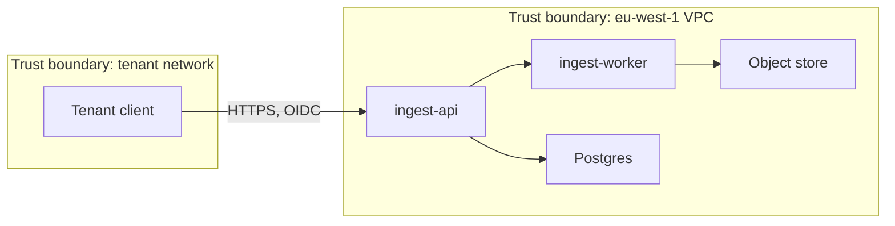
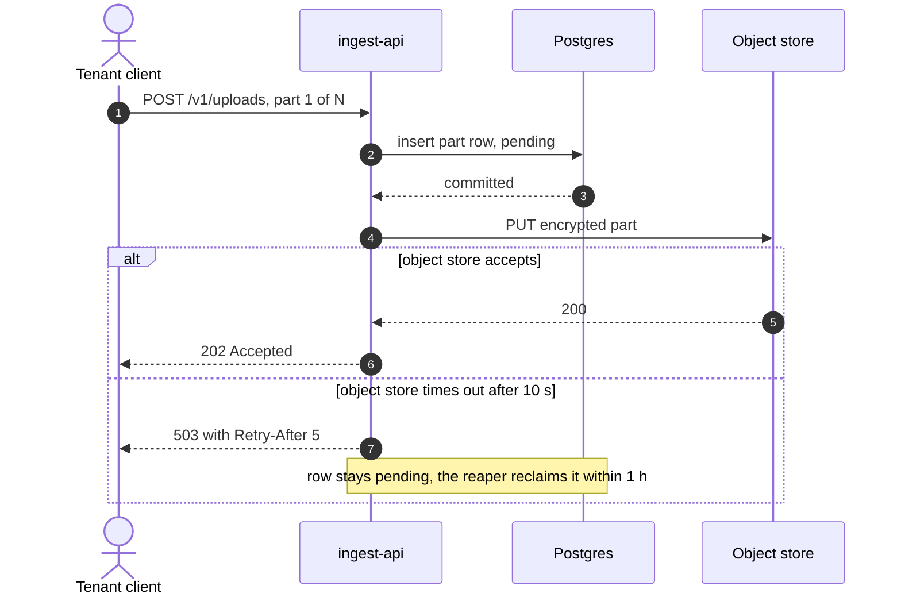

# Limen Reference: Section Templates

**Companion to** [`LIMEN.md`](LIMEN.md) **6.1.0.** Load the template for the
section you are writing, not the whole file.

Templates are illustrations, not forms. Their rows show the kind of content that
makes a section useful; replace them with your system's, delete columns that say
nothing for it, and keep a section to a paragraph when a paragraph is enough
(LIMEN.md §12). Tags, pointers and ids follow LIMEN.md §3.

Sections 1 to 11 match the skeleton (LIMEN.md §5.1). Sections 12 to 20 are the
triggered sections (LIMEN.md §5.4). Section 21 is optional guidance for
designing, and section 22 is the audit record.

---

## 1. Summary

Written last. About two pages. A reader who stops here should know what the system
is, what it trades, and where it is weak.

```markdown
## Summary

**What it is.** Ingest accepts tenant uploads of up to 24 MiB per part and stores
them durably in one EU region. Three deployables: `ingest-api`, `ingest-worker`,
`ingest-gc`.

**Shaping decisions.**
- Keys are derived per request (`ADR-011`); this costs about 18 ms of p95 latency.
- Writes are acknowledged after the metadata commit, not the blob write
  (`ADR-009`); this makes the blob store eventually consistent.

**Invariants.** 4 tested, 1 untested, 1 violated: the reaper and the API both
write `uploads` (see Invariants, `R-09`).

**Known divergences.** The README says Redis; the deployment runs Memcached (`Q-02`).

**Top risks.** `R-06` retry budget exceeds the load-balancer timeout. `R-01`
internal gRPC is unauthenticated.

**Blocking questions.** `Q-01` decides whether the part ceiling can rise.
```

---

## 2. Problem, scope and non-goals

```markdown
## Problem, scope and non-goals

**Problem.** Uploads over 8 MiB time out at p99 because the API buffers whole
objects in memory `[verified]` (`internal/ingest/handler.go@a1b2c3d::(*Handler).Upload`).

**In scope.** Multipart upload, durable storage, the completion event.

| Non-goal | Why it is out | Who decided |
| :--- | :--- | :--- |
| Cross-region strong consistency in phase 1 | One region meets `K-01`; two double the write path | `ADR-009` |
| Client-side encryption | Key custody would move to tenants, and support cannot recover their data | `ADR-011` |
```

A non-goal earns its row only if a reasonable reviewer might have argued for it.

---

## 3. Stakeholders and constraints

| ID | Stakeholder | Role | What they need to know |
| :--- | :--- | :--- | :--- |
| `C-01` | Platform SRE | operates | Which component caused an incident, within 5 minutes |
| `C-02` | Tenant admin | uses | Whether my tenant's data is isolated from others |
| `C-03` | Security review | audits | What crosses a trust boundary unauthenticated |
| `C-04` | Finance | funds | What a marginal tenant costs per month |

Write concerns as the stakeholder's questions, not as system features. Cover
distinct roles, not four developers.

| ID | Class | Constraint | Source | Negotiable | If violated |
| :--- | :--- | :--- | :--- | :--- | :--- |
| `K-01` | legal | EU tenant data stays in eu-west-1 | DPA §7 | No | Regulatory exposure |
| `K-02` | technical | Postgres is the only approved datastore | Platform RFC-88 | Hard | Unsupported in production |
| `K-03` | organisational | Four engineers, no dedicated SRE | Team charter | No | Caps operational complexity |
| `K-04` | temporal | Ship before the Q3 change freeze | Programme plan | Soft | Slips a quarter |

A constraint you cannot source is an open question, not a constraint.

---

## 4. Quality priorities

### 4.1 Scenarios and conflicts

Rank three to six attributes. Give each a scenario with a measure a test could
fail.

| ID | Rank | Attribute | Scenario | Measure | Tier |
| :--- | :--- | :--- | :--- | :--- | :--- |
| `QA-01` | 1 | Isolation | A compromised tenant credential requests another tenant's upload | 0 cross-tenant reads | `[inferred]` |
| `QA-02` | 2 | Availability | One AZ fails during peak | 99.5% of writes succeed over 10 min | `[inferred]` |
| `QA-03` | 3 | Latency | A 24 MiB part is uploaded at 2x median load | p95 at most 250 ms, p99 at most 900 ms | `[inferred]` |

| Conflict | Tension | Winner | Why | ADR |
| :--- | :--- | :--- | :--- | :--- |
| `QA-01` vs `QA-03` | Per-request key derivation adds about 18 ms | `QA-01` | A leaked key cannot be un-leaked; latency can be recovered elsewhere | `ADR-011` |

"Fast" and "highly available" are not measures. A conflict list in which every
attribute wins was not a conflict list.

A scenario is a target. Saying the system meets it today is a claim about a
property, so either try to break it (LIMEN.md rule 5) or tag it `[inferred]`. A
priority tagged `[verified]` because the mechanism behind it exists is the
commonest wrong tier.

### 4.2 Sizing

Show the arithmetic, so a reviewer can recompute it when an input changes.

```text
Inputs
  Tenants             1,200 today, 3,000 planned        [inferred] product plan
  Uploads per tenant  140/day median                    [verified] analytics export
  Part ceiling        24 MiB                            [verified] limits.go::MaxPartBytes

Derivation
  Writes per day  = 1,200 x 140           = 168,000
  Mean rate       = 168,000 / 86,400      = 1.9/s
  Peak rate       = mean x 12 (measured)  = 23/s
  Design point    = 2 x peak              = 50/s
```

---

## 5. Context and containers

One context diagram and one container diagram, with trust boundaries drawn. Each
container is a deployment unit, taken from the infrastructure config rather than
the package layout.



Follow each diagram with what the reader should conclude: *"Only `ingest-api` is
reachable from outside; the worker trusts anything inside the VPC, which is
`R-01`."*

---

## 6. Key decisions and ADRs

### 6.1 The index

| Decision | Chosen | Rejected | Sacrifices | ADR | Tier |
| :--- | :--- | :--- | :--- | :--- | :--- |
| Key lifetime | Per-request derivation | Per-session cache; envelope encryption with a cached key | `QA-03` (about 18 ms) | `ADR-011` | `[verified]` |
| Write durability | Ack after metadata commit | Ack after blob write | Blob consistency becomes eventual | `ADR-009` | `[verified]` |

A row with nothing in Sacrifices is a preference, not a decision.

### 6.2 An ADR

One decision per file, `docs/adr/ADR-011-per-request-key-derivation.md`.
Append-only: a reversal is a new ADR that supersedes this one.

```markdown
---
id: ADR-011
title: Derive tenant data keys per request
status: accepted        # proposed | accepted | rejected | deprecated | superseded
date: 2026-07-14
superseded_by: null
---

# ADR-011: Derive tenant data keys per request

## Context
Caching a derived key for a session cuts latency but widens the window in which
one process holds key material for many tenants. `QA-01` requires isolation to
hold under a compromised credential.

## Options
**A. Per-request derivation (chosen).** Key lifetime is one request; there is no
cache to run. Costs about 18 ms of p95, measured, and about 40x the KMS calls.

**B. Per-session cache with a TTL.** Near-zero added latency. Key material for
many tenants sits in one process, and the TTL becomes a security knob nobody
revisits.

**C. Envelope encryption, cached data key.** Bounded exposure, but two key
hierarchies to reason about for a marginal gain over A.

## Decision
A. `QA-01` is the only attribute whose failure cannot be undone.

## Consequences
- Sacrifices: `QA-03` loses 18 ms of its 250 ms budget.
- KMS becomes a hard dependency of the write path (`R-07`).
- Revisit if KMS p99 exceeds 25 ms, or writes exceed 4,000/s.
```

Every option a competent engineer would not choose is a straw man; at least one
rejected option should be genuinely tempting. A small decision can be one
sentence: *"For the GC worker, facing unbounded delete fan-out, we chose batched
deletes of 5,000 rows over one cascading transaction, to bound lock time, accepting
up to 30 minutes of eventual deletion."*

---

## 7. Invariants

What must always hold, how it was checked (LIMEN.md rule 5), and whether a test
enforces it (rule 7).

| Invariant | Tier | Basis | Checked | Status |
| :--- | :--- | :--- | :--- | :--- |
| Only the part store writes `uploads` | `[verified]` | `internal/ingest/store.go@a1b2c3d::Store` | `git grep -n "INSERT INTO uploads\|UPDATE uploads" a1b2c3d`: 2 writers, the store and `internal/gc/sweep.go` | `violated`, `R-09` |
| A part never exceeds 24 MiB | `[verified]` | `internal/ingest/limits.go@a1b2c3d::MaxPartBytes` = 25165824 | Every caller of `Admit` checks it; `TestRejectsOversizedPart` fails when the check is removed | `tested` |
| A request never waits more than 30 s | `[inferred]` | ALB timeout 30 s, with the hop budget in Failure | Summed the retry budget: 53 s worst case | `violated`, `R-06` |
| Tenant reads are scoped by tenant | `[verified]` | `internal/repo/upload.go@a1b2c3d::scopeTenant` | Read every query in `internal/repo`; no test exists | `untested` |

`tested` means a test exists **and** you watched it fail when the invariant was
broken. Say how in the Checked column.

---

## 8. Data and consistency

| Flow | Consistency | Atomic? | Delivery | Idempotency key | Ordering | Tier |
| :--- | :--- | :--- | :--- | :--- | :--- | :--- |
| Upload to metadata row | Strong | Yes, one transaction | n/a | `Idempotency-Key` header | n/a | `[verified]` |
| Metadata to object store | Eventual, 30 s or less | **No**: row commits first | n/a | object key `{tenant}/{upload_id}` | n/a | `[verified]` |
| Upload to `ingest.completed` | Eventual, 5 s or less | Outbox | At least once | `upload_id` | Per tenant | `[verified]` |

**Half-failure, for every non-atomic row.** *The row commits and the blob write
fails: the row stays `pending`, and the reaper reclaims rows pending over an hour
`[verified]` (`internal/gc/sweep.go@a1b2c3d::sweepPending`). A client polling during
the window sees `pending`, never a 404.*

| State | Owner | Other readers | Other writers |
| :--- | :--- | :--- | :--- |
| `uploads` table | `ingest-api` | `ingest-worker` | **`ingest-gc`**: shared mutable state, `R-09` |

Exactly one component owns each piece of state; a second writer is a finding.
State any logic that depends on wall-clock time, and its skew tolerance.

---

## 9. Failure and degradation

| Dependency | Hard or soft | On failure | Timeout | Retries | Fallback | Tier |
| :--- | :--- | :--- | :--- | :--- | :--- | :--- |
| Postgres | Hard | Reads and writes fail | 3 s | 2 | None; fail fast with 503 | `[verified]` |
| Object store | Hard for writes | Upload fails after metadata | 10 s | 3 | Row stays pending | `[verified]` |
| Event bus | Soft | Events delayed | 2 s | 3 | Outbox drains on recovery | `[verified]` |

**Timeout budget.** The downstream worst cases must fit inside the upstream timeout:

| Hop | Timeout | Retries | Worst case | Running total |
| :--- | :--- | :--- | :--- | :--- |
| ALB to api | 30 s | 0 | 30 s | budget |
| api to Postgres | 3 s | 2 | 9 s | 9 s |
| api to object store | 10 s | 3 | 40 s | **49 s, over the 30 s budget**: `R-06` |

State the retry amplification: three retries at each of three layers is up to 64
calls on the deepest dependency.

| Failure | Upload | Read | Events | Notes |
| :--- | :--- | :--- | :--- | :--- |
| Object store down | no | cached only | yes | Pending rows accumulate |
| Postgres down | no | no | delayed | Full outage |
| Event bus down | yes | yes | delayed | Outbox drains later |

A system with no degraded mode has one mode: down. If none was designed, say so.

---

## 10. Security

```markdown
**Assets.** Tenant payloads (may contain personal data), per-tenant keys, the OIDC
client secret, object-store credentials, availability.

**Adversaries.** Unauthenticated internet; an authenticated tenant; a stolen
tenant credential; a compromised dependency; a compromised CI or agent credential.

**Assumptions, trusted and therefore undefended.**
- The cloud KMS is trusted `[inferred]`.
- Base images are verified by the platform team `[unknown]`, see `Q-07`.
```

| Boundary | Top threat | Control | Residual | Risk |
| :--- | :--- | :--- | :--- | :--- |
| Internet to `ingest-api` | Cross-tenant read by guessing ids | Tenant predicate in the repository layer, row-level security | **Medium**: 2 of 11 tables lack RLS | `R-03` |
| `ingest-api` to `ingest-worker` | Lateral movement from any pod | None; internal gRPC is unauthenticated | **High** | `R-01` |

A threat model with no medium-or-higher residual risk was probably not done.
Where the full sweep is triggered, use §14.

---

## 11. Risks and open questions

| ID | Type | Description | Impact | Owner | Mitigation or trigger | Tier |
| :--- | :--- | :--- | :--- | :--- | :--- | :--- |
| `R-01` | Risk | Internal gRPC is unauthenticated | High | @security | mTLS through the mesh, when it reaches this namespace | `[verified]` |
| `R-06` | Issue | Object-store retries exceed the 30 s ALB timeout | Medium | @ingest | Reduce retries to 1 | `[inferred]` |
| `TD-01` | Debt | RLS missing on 2 of 11 tables | Manual review on every repo PR | @ingest | Before the next tenant tier | `[verified]` |

For debt, state the interest (what it costs to keep) and the principal (what it
costs to fix). A mitigation the risk depends on is a claim too: check that it
would work (LIMEN.md rule 5) before recording it, because a fix that cannot work
leaves the risk open while the document says it is handled.

| ID | Question | Why it matters | Owner | How it gets resolved |
| :--- | :--- | :--- | :--- | :--- |
| `Q-01` | Is the 24 MiB limit a protocol constraint or a tuned value? | Decides whether sizing can relax | @ingest-lead | git blame the constant, ask its author |
| `Q-02` | README says Redis, the deployment runs Memcached: which is live? | Changes the failure analysis | @platform | Read the running config |

---

## 12. Contract catalogue and versioning

| ID | Contract | Kind | Consumers | Auth | Idempotent | Limits | Tier |
| :--- | :--- | :--- | :--- | :--- | :--- | :--- | :--- |
| `I-01` | `POST /v1/uploads` (`internal/api/upload.go@a1b2c3d::handleUpload`) | REST | SDK, web | OIDC | Yes, `Idempotency-Key` | 24 MiB per part | `[verified]` |
| `I-02` | `ingest.completed` (`internal/events/publish.go@a1b2c3d::Publish`) | Event | billing, search | IAM | At least once | 256 KiB | `[verified]` |

State what counts as a breaking change, the deprecation window and how it is
signalled, and the rules for evolving event schemas, including what consumers must
tolerate.

**When a consumer is an agent,** three things become load-bearing: how it
discovers the schema at run time, and whether that schema is generated from the
code or maintained by hand; structured errors carrying `code`, `path`,
`expected`, `actual` and `retryable`, because prose errors cannot be corrected,
only read; and how many correction attempts the contract expects before the
consumer stops.

---

## 13. Proposed change

Everything here is `[proposed]`. Nothing outside this section describes the change.

| As-is | To-be | Change | Revertible |
| :--- | :--- | :--- | :--- |
| `ingest-api`, one region | `ingest-api`, two regions | modified | Per increment |
| none | `region-router` | new | Yes |
| `pkg/legacy/replicator` | none | removed | No, after step 6 |

| # | Increment | Ships alone | Revert path | Revert expires | Exit criterion |
| :--- | :--- | :--- | :--- | :--- | :--- |
| 1 | Add a nullable `region` column and backfill it | Yes | Drop the column | 30 days | Every row populated |
| 2 | Run `region-router` in shadow mode | Yes | Turn off the flag | 14 days | Shadow diff under 0.01% |
| 3 | Dual-write to the second region | Yes | Turn off the flag | 14 days | Reconciliation clean for 7 days |

For data: the dual-write window, the backfill and its rate, the query that proves
both sides agree, the cutover criteria, and what happens to writes in flight.
For decommissioning: what is deleted, when, and what proves it is safe, such as
zero traffic for 30 days.

---

## 14. STRIDE per trust boundary

One table per boundary in the container diagram. Every category gets a row, with
"not applicable because..." rather than a blank.

| Category | Threat | Control | Pointer | Residual | Risk |
| :--- | :--- | :--- | :--- | :--- | :--- |
| Spoofing | Forged tenant identity | OIDC; `aud` and `iss` checked | `internal/auth/oidc.go@a1b2c3d::Verify` | Low | n/a |
| Tampering | Payload altered in transit | TLS 1.3 at the ALB; part checksums | `deploy/terraform/alb.tf@a1b2c3d::aws_lb_listener.https` | Low | n/a |
| Repudiation | Tenant denies an upload | Audit log of `sub` and `upload_id`, 400-day retention | `internal/audit/log.go@a1b2c3d::Record` | Low | n/a |
| Information disclosure | Cross-tenant read | Tenant predicate and RLS | `internal/repo/upload.go@a1b2c3d::scopeTenant` | **Medium** | `R-03` |
| Denial of service | Large-payload flood | Part cap, per-tenant rate limit; **no global cap** | `internal/api/ratelimit.go@a1b2c3d::Limit` | **Medium** | `R-05` |
| Elevation of privilege | Tenant gains admin scope | Scopes checked per handler | `internal/auth/scope.go@a1b2c3d::Require` | Low | n/a |

Add at least two abuse cases as sequence diagrams with the adversary as an actor.

---

## 15. SLOs and fitness functions

| ID | Indicator | Target | Window | From | Alert | Runbook |
| :--- | :--- | :--- | :--- | :--- | :--- | :--- |
| `SLO-01` | Upload success rate | 99.9% | 30 days | `QA-02` | Burn rate 14.4x over 1 h | `RB-01` |
| `SLO-02` | Upload acknowledgement p95 | 250 ms | 30 days | `QA-03` | Over target for 10 min | `RB-02` |

Every SLO names the quality scenario it comes from. Every alert names a runbook and
an owner.

A fitness function is a check that fails when a quality attribute degrades:

| ID | Attribute | Check | Where | Threshold | On failure | Seen failing |
| :--- | :--- | :--- | :--- | :--- | :--- | :--- |
| `FF-01` | Isolation | Tenant A's token reads tenant B's rows, across all tables | CI, every PR | 0 reads | Block merge | Removed `scopeTenant`, the test failed |
| `FF-02` | Latency | Load test at 50/s with 24 MiB parts | Nightly | p95 at most 250 ms | Block release | Not yet: `untested` |

Each top-ranked quality attribute gets a fitness function, or a stated reason it has
none. Say where each actually runs: a test nobody invokes is an intention, not a
check.

---

## 16. Data governance and deletion cascade

| Data | Class | Residency | Retention | Encryption | Tier |
| :--- | :--- | :--- | :--- | :--- | :--- |
| Payloads | Restricted, may hold personal data | eu-west-1 (`K-01`) | 90 days hot, 400 cold | Per-tenant key | `[verified]` |
| Telemetry | Internal | **us-east-1** | 15 days | Vendor managed | `[verified]`, conflicts with `K-01`: `R-08` |

| Step | Store | Mechanism | Delay | Verified by | Tier |
| :--- | :--- | :--- | :--- | :--- | :--- |
| 1 | `uploads` row | Soft delete | Immediate | `FF-08` | `[verified]` |
| 2 | Blobs | Reaper | 30 min or less | `FF-08` | `[verified]` |
| 3 | CDN cache | Purge call | 5 min or less | none | `[proposed]`, owner @platform, trigger: first deletion request from an EU tenant |
| 4 | **Backups** | Snapshot expiry | **35 days or less** | none | `[verified]` |
| 5 | **Logs** | Retention expiry | 15 days or less | none | `[verified]` |
| 6 | **Analytics warehouse** | Scheduled purge | 24 h or less | none | `[unknown]`, `Q-09` |

A deletion story that stops at the primary database is not a deletion story.

---

## 17. Cost model

| Component | Driver | Rate | At 1,200 tenants | At 3,000 | Tier |
| :--- | :--- | :--- | :--- | :--- | :--- |
| Postgres, multi-AZ | Instance hours | $0.68/h | $992 | $1,984, a scale step | `[inferred]` |
| Object storage | GiB-months | $0.023 | $1,070 | $2,675 | `[inferred]` |
| KMS | Requests | $0.03 per 10k | $310 | $775 | `[inferred]`, from `ADR-011` |
| **Per tenant** | | | **$2.00** | **$2.15** | |

Report cost per unit of business value, name the dominant driver, and say where
the next scale step lands.

---

## 18. Rollout, rollback and recovery

| Stage | Traffic | Advance when | Roll back when | Soak |
| :--- | :--- | :--- | :--- | :--- |
| Canary | 1 pod, about 3% | Errors within budget; p95 within `SLO-02` | `SLO-01` burns faster than 2x | 30 min |
| Partial | 25% | No new alert classes | Pending backlog rising for 10 min | 2 h |
| Full | 100% | Both earlier gates held | On-call judgement | 24 h before the next change |

For a schema change, use expand and contract, and **name the one-way door**: the
step after which rollback is no longer possible.

| Property | Value | Evidence |
| :--- | :--- | :--- |
| Rollback | Redeploy the previous image; flags off | `deploy/rollback.sh@a1b2c3d::rollback` |
| Last exercised | 2026-08-14, staging, 4 min | Drill record |
| Restore from backup | RPO 5 min, RTO 1 h | **Never drilled**: `R-11` |

An untested rollback or restore is a hypothesis. Date every claim that one works.

---

## 19. Component deep-dives

Only for a container too complex to explain in the container section.

| Component | Responsibility | Owns | Concurrency | Pointer | Tier |
| :--- | :--- | :--- | :--- | :--- | :--- |
| `upload handler` | Validates and admits a multipart upload | Nothing; stateless | Per request | `internal/ingest/handler.go@a1b2c3d::(*Handler).Upload` | `[verified]` |
| `part store` | Single writer of `uploads` and `parts` | Both tables | One row lock per upload | `internal/ingest/store.go@a1b2c3d::Store` | `[verified]` |

For each component that carries risk: what it does when each dependency fails,
what its caller sees, how it recovers, and where it applies back-pressure. A
component entry that covers only the happy path has documented the easy half.

---

## 20. Sequence flows

At least one success path and one failure path. The failure path is the one worth
drawing.



| # | Hop | Timeout | On failure | Client sees |
| :--- | :--- | :--- | :--- | :--- |
| 2 | api to Postgres | 3 s, 2 retries | Abort before any blob is written | 503 |
| 4 | api to object store | 10 s, 3 retries | Row left pending | 503, then pending on poll |

Use the container diagram's names, show what the client observes rather than
"returns an error", and make the timeouts agree with the budget in Failure.

---

## 21. Designing: candidates, walkthrough, premortem

Optional guidance for creating a design rather than extracting one.

**1. Candidates.** Write at least two, each a paragraph and a container sketch,
that differ in at least one of: deployment units, state ownership, consistency
model, sync and async boundaries, or trust-boundary placement. Two variants of one
design count as one candidate. In a change, the current design is candidate zero.

**2. Walkthrough.** Put the candidates against the top three to five quality
scenarios.

| Scenario | A: monolith with outbox | B: API plus queue plus workers | C: current design |
| :--- | :--- | :--- | :--- |
| `QA-02` one AZ fails | Fails over with the database, about 60 s of errors | Queue absorbs, workers resume | Writes fail until manual failover |
| `QA-03` p95 under peak | 180 ms | 140 ms | 310 ms |
| `K-03` four engineers | One deployable | Three, plus a queue to operate | Two |

The chosen candidate should lose somewhere. If it wins every row, the others were
straw men.

**3. Premortem.** *"A year from now this design failed. Why?"* Write at least three
causes specific to this design, and turn each into a risk, a quality scenario or a
fitness function.

**4. Decide** in an ADR that cites the rows it trades (§6.2).

---

## 22. Audit record

Written by the auditor to `docs/architecture/audits/<date>-<version>.md`.

```markdown
# Audit: Ingest Platform HLD 2.1.0

**Baseline:** a1b2c3d · **Date:** 2026-10-02 · **Auditor:** agent, fresh session,
model <id>; same family as the author, so shared blind spots are possible.
**Verdict:** Not reviewable (two blockers)

## Checks
`limen check --strict`: 5 passed.

## Falsification attempts
| Claim | How I tried to break it | Outcome |
| :--- | :--- | :--- |
| A part is never stored without its tenant | Uploaded through each of the three entry points with the tenant header stripped | **Refuted**: the batch endpoint stores the part with a null tenant |
| Only the part store writes `uploads` | `git grep` for writers at a1b2c3d | Confirmed the disclosed violation; nothing new |

## Claims sampled
12 tagged claims read against the code: 10 true, 1 value wrong, 1 sentence false.

## "Checked" lines rerun
3 rerun, 3 reproduced.

## Tests credited with invariants
`TestRejectsOversizedPart` fails when the size check is removed. Confirmed.

## Arithmetic
Sizing reproduced. Timeout budget: the document says 49 s; recomputed, 52 s,
because the KMS retry was left out.

## Silence
- Operates: no runbook for the pending-backlog alert.
- Audits: the deletion cascade omits the analytics warehouse.

## Previous audit, read last
2.0.0's audit refuted 3 claims. 2 were repaired. 1 is still in the document:
"the reaper is the only deleter of blobs" is still false (`admin/purge.go` deletes
too), so it is a blocker again. Found only by this step.

## Findings
| Severity | Finding |
| :--- | :--- |
| Blocker | The tenant invariant is false on the batch endpoint and not disclosed |
| Major | Operators cannot act on the pending-backlog alert |
| Blocker | "The reaper is the only deleter of blobs", refuted by the previous audit, is still in the document |
| Minor | The context diagram omits the event bus |
```
