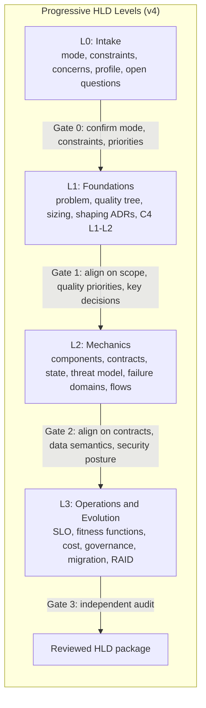

# Engineering Standard: Agent-Authored HLD — Framework & Process

**Document Reference:** `STD-ARCH-HLD-01`
**Version:** 4.0.0
**Status:** Canonical
**Supersedes:** `STD-ARCH-LLM-HLD-002` v3.0.0 (single-file Progressive Multi-Level Standard)
**Companion Documents:**
- `STD-ARCH-HLD-02-Templates.md` — section templates, table schemas, front matter
- `STD-ARCH-HLD-03-Audit.md` — tailoring profiles, hard gates, scoring rubric, validator spec

**Audience:** Autonomous coding agents, AI architecture agents, engineering leads, ARB reviewers.

---

## 0. What this standard is for

An agent asked to "write an HLD" will, left alone, produce a document that is
complete, confident, well-formatted, and substantially untrue. It will invent
components from import statements, assert trade-offs it never evaluated, and
describe a target architecture in the present tense.

This standard exists to make that failure mode **detectable and expensive**. It
does so with four mechanisms, in descending order of importance:

1. **Provenance** (§5) — every factual claim about code carries a
   machine-resolvable pointer. Claims that no longer resolve fail CI.
2. **Evidence tiers** (§4) — every normative statement is tagged as verified
   fact, synthesis, proposal, or open question. There is always a legal place to
   put uncertainty, so guesses never need to be laundered into facts.
3. **Progressive gates** (§3) — alignment on assumptions is confirmed by a human
   before downstream work compounds on them.
4. **Adversarial audit** (`-03`) — the document is scored by an agent that did
   not write it and cannot see the authoring context.

Everything else in this standard is section structure, which is the easy part.

> **Non-goal.** This standard does not make a system production-ready. It makes a
> *document* fit to be reviewed by people who can judge whether the system is.

---

## 1. Operating modes

Mode is selected at intake (§2) and determines required sections, evidence rules,
and audit profile. Mode is recorded in front matter and cannot change mid-document.

| Mode | When | Tier 1 anchors to | Distinguishing requirement |
| :--- | :--- | :--- | :--- |
| `greenfield` | System does not exist yet | PRD/RFC requirements, external standards (RFC 6749, etc.), arithmetic sizing bounds | Every component is T3 by definition; the doc must not use present tense for anything unbuilt |
| `brownfield-asis` | Documenting an existing system | Repository at a pinned commit | ≥70% of §L2 claims must carry resolvable provenance; no proposals mixed into as-is sections |
| `brownfield-change` | Designing a change to an existing system | Repository at a pinned commit, for as-is; requirements, for to-be | **As-is and to-be are physically separate sections.** A delta table (§L3.6) is mandatory. This is the most common real case and the easiest to get wrong |

**Rule M-1.** In `brownfield-change`, no paragraph may describe as-is and to-be
state together. If a sentence needs the word "will", it belongs in a to-be block.

**Rule M-2.** In `greenfield`, the phrase "the system does X" is prohibited.
Use "the system will do X" or "Proposed: X". The audit penalizes present-tense
description of unbuilt behavior as a hard gate failure, not a style nit.

---

## 2. Level 0 — Intake (new in v4)

L0 is cheap, fast, and produces no prose. It exists because most bad HLDs are bad
before the first paragraph: wrong mode, unknown constraints, unnamed stakeholders,
no idea which quality attributes matter.

**L0 must be completed and presented before any L1 content is written.**

### 2.1 Required L0 outputs

| # | Output | Template |
| :--- | :--- | :--- |
| L0.1 | Mode selection + justification | `-02` §1 |
| L0.2 | Repository baseline: URL + commit SHA + dirty-tree flag | `-02` §2 |
| L0.3 | Stakeholder & concern register (`C-nn` IDs) | `-02` §3 |
| L0.4 | Constraints register (`K-nn` IDs) | `-02` §4 |
| L0.5 | Tailoring profile selection + weight table | `-03` §2 |
| L0.6 | Open Questions register (`Q-nn` IDs), seeded | `-02` §5 |
| L0.7 | Discovery report (brownfield only) | §6 of this doc |

### 2.2 Why constraints come before everything

arc42 §2 exists because **constraints are what make an architecture non-obvious.**
An agent that does not know the team is committed to Postgres, cannot deploy
outside eu-west, has four engineers, and must ship by Q3 will design a beautiful
system nobody can build. Constraint discovery is not optional and is not
inferrable from code alone — if constraints cannot be established, that is a `Q-nn`
Open Question, not an assumption.

Constraint classes to probe for: organizational (team size, ownership, on-call),
legal/regulatory (residency, retention, audit), technical mandates (approved
platform, language, datastore), commercial (budget, vendor commitments, license),
temporal (deadline, migration window), and operational (existing runbook,
deployment cadence, change-freeze windows).

### 2.3 Seeding the Open Questions register

At L0, the agent must record every question whose answer would change the design.
A mature L0 has **5–20 open questions**. An L0 with zero open questions is a
signal the agent is guessing, and the audit treats it as such (`-03` G8).

---

## 3. Progressive levels and gates

### 3.1 The actual reason for gating

v3 justified progressive delivery with output-token exhaustion and a "detail
fatigue curve." For a tool-using agent that writes files incrementally, those are
largely solved. The real and permanent justification is the third one v3 listed
and then buried:

> **Compounding unvalidated assumptions.** A misread requirement at L1 corrupts
> every schema, flow, and cost model downstream, with no opportunity for
> mid-course correction.

Gates are **human alignment checkpoints**, not context-window workarounds.

**Corollary G-1.** Levels are not turns. An agent may write section-per-file
against the manifest in any order its tooling prefers, and may parallelize within
a level. What it may not do is present L2 for review before L1 is gate-approved.

**Corollary G-2.** If the user explicitly requests all levels in one pass, the
agent complies but must emit an `Ungated` banner in front matter and the audit
applies a fixed deduction (`-03` §5).

### 3.2 Level map



### 3.3 Level 1 — Foundations

*Objective: establish what problem is being solved, which quality attributes win
when they conflict, what the decisions were, and what the top-level topology is.*

| § | Section | Mandatory | Notes |
| :--- | :--- | :--- | :--- |
| L1.1 | Problem statement & business context | always | Specific bottleneck, not a mission statement |
| L1.2 | Scope matrix: in-scope vs non-goals | always | Non-goals carry more review value than scope |
| L1.3 | Personas & domain glossary | always | Glossary terms become the controlled vocabulary for the whole doc |
| L1.4 | **Quality tree & prioritized QA scenarios** | always | §3.4 below — the load-bearing new section |
| L1.5 | Architecture principles & invariants | always | 4–6; each must be falsifiable |
| L1.6 | Back-of-envelope sizing & capacity bounds | always | Show the arithmetic, not just the result |
| L1.7 | **Constraint slice**: security, data class, cost, residency | always | §3.5 below |
| L1.8 | C4 L1 System Context | always | |
| L1.9 | C4 L2 Container topology **with trust boundaries** | always | Doubles as the threat-model DFD at L2.5 |
| L1.10 | Shaping decisions → ADR index | always | The ADRs themselves live outside the HLD (§3.7) |

### 3.4 L1.4 — Quality tree and QA scenarios (the biggest v3 gap)

v3 deferred quality to an L3 SLO table. That is backwards: **quality attributes
drive architecture; SLOs merely measure the result.** Without prioritized quality
attributes, a trade-off matrix has no axis to trade on, and "eliminates connection
leaks" is an assertion rather than a comparison.

Required structure (arc42 §10 quality tree + SEI six-part scenarios):

1. **Quality tree.** Top-level attributes (availability, latency, security,
   modifiability, operability, cost-efficiency…) refined into concrete
   sub-attributes, each with a **priority pair**: `(business importance,
   architectural difficulty)`, each H/M/L. This is the ATAM utility tree.
2. **Scenarios.** For every H/H and H/M leaf, a six-part scenario:
   *source of stimulus, stimulus, artifact, environment, response,
   **response measure***. See `-02` §7.
3. **Conflict set.** An explicit list of scenario pairs that are in tension, and
   which one wins. This is the input to every trade-off in the document.

**Rule Q-1.** A quality attribute without a response measure is decoration.
Hard gate G5 fails the document.

**Rule Q-2.** Every SLO in L3.1 must cite the `QA-nn` scenario it derives from.
SLOs invented at L3 with no L1 ancestor are flagged.

**Rule Q-3.** Minimum 5 scenarios; a system with fewer than 3 H-importance
quality attributes is probably not worth an HLD at this weight — recommend the
lightweight profile (`-03` §2, `P5`).

### 3.5 L1.7 — The constraint slice

Security, data governance, and cost are treated in v3 as L2/L3 deep-dive topics.
Three of their decisions are *topology-shaping* and must land at L1 or the C4
container diagram is dishonest:

| Decision | Why it is L1 | Deep-dive lives at |
| :--- | :--- | :--- |
| Tenancy model (silo / pool / bridge) | Determines container count, data partitioning, and blast radius | L2.4 |
| Trust boundary placement | Cannot draw an honest C4 L2 without it; directly seeds the threat model | L2.5 |
| Data classification & residency | Determines region topology, encryption obligations, replication legality | L3.3 |
| Region/AZ topology | Order-of-magnitude cost consequence; not an L3 "FinOps model" output | L3.2 |

### 3.6 Level 2 — Mechanics

| § | Section | Mandatory | Notes |
| :--- | :--- | :--- | :--- |
| L2.1 | Component deep-dives (C4 L3) | always | Responsibility, concurrency model, owned state, failure behavior |
| L2.2 | **Interface & contract catalogue** | always | Every externally-reachable contract, in one table |
| L2.3 | **Compatibility & versioning policy** | always | Breaking-change rules, deprecation window, event schema evolution |
| L2.4 | **Data, state & consistency semantics** | always | §3.6.1 below — second-biggest v3 gap |
| L2.5 | **Threat model (STRIDE per trust boundary)** | always | §3.6.2 below |
| L2.6 | **Failure domains & degradation modes** | always | §3.6.3 below |
| L2.7 | Runtime sequence flows | always | ≥1 happy path, ≥1 failure/recovery path |
| L2.8 | Ownership map (container → team → on-call) | profile-dependent | Conway's law is an architectural constraint |

#### 3.6.1 L2.4 — Data, state and consistency

An ERD is a schema, not a data architecture. Required beyond the ERD:

- **Consistency guarantees per data flow**: strong / read-your-writes / eventual,
  and the window for eventual.
- **Transaction boundaries**: what commits atomically, what does not, and what
  the system does when a multi-step operation half-fails.
- **Delivery semantics**: at-most-once / at-least-once / effectively-once per
  queue or stream, and the idempotency key that makes it safe.
- **Ordering guarantees**: per-partition, global, or none — and what breaks if
  violated.
- **Clock assumptions**: any logic depending on wall-clock ordering, skew
  tolerance, or TTL correctness.
- **State ownership**: exactly one component owns each piece of state. Shared
  mutable state across components is a finding, not a design.

#### 3.6.2 L2.5 — Threat model

v3's security section is an inventory of auth mechanisms. An inventory tells you
what exists; it never tells you what can go wrong. Required:

1. **Assets** — what an adversary wants (data classes from L1.7, credentials,
   compute, availability).
2. **Adversaries** — external unauthenticated, authenticated tenant, malicious
   insider, compromised dependency, compromised agent/automation credential.
3. **Security assumptions** — what is trusted and therefore not defended
   (e.g. "the cloud provider's KMS is trusted"). Unstated assumptions are the
   ones that fail.
4. **STRIDE sweep** — for each trust boundary on the L1.9 diagram, each of
   Spoofing, Tampering, Repudiation, Information disclosure, Denial of service,
   Elevation of privilege: threat, existing control, residual risk, `R-nn` link.
5. **Abuse cases** — ≥2 narrative misuse flows, diagrammed like sequence flows.

The C4 L2 diagram with trust boundaries *is* the DFD; drawing it twice is waste.

#### 3.6.3 L2.6 — Failure domains and degradation

The thinnest section in almost every agent-written HLD, and the one operators
actually read. Required:

- **Dependency criticality table** — per dependency: hard or soft, what happens
  on failure, timeout, retry policy, fallback.
- **Timeout & retry budget** — end-to-end budget decomposed per hop. The sum of
  downstream timeouts must not exceed the upstream timeout; violations are a
  finding. Include jitter and retry-amplification analysis.
- **Backpressure & load shedding** — where queues bound, what is shed first.
- **Degradation matrix** — rows are components, columns are "what still works".
  A system with no documented degraded mode has exactly one mode: down.
- **Blast radius** — per failure domain, the set of tenants/regions/features
  affected.

### 3.7 Level 3 — Operations and evolution

| § | Section | Mandatory | Notes |
| :--- | :--- | :--- | :--- |
| L3.1 | SLO/SLI & error budget | always | Each traced to an `QA-nn` scenario |
| L3.2 | **Fitness functions** | always | §3.7.1 below |
| L3.3 | Observability, telemetry & alert→runbook matrix | always | Every alert names a runbook and an owner |
| L3.4 | Cost model & unit economics | profile-dependent | Cost per unit of business value, not just monthly totals |
| L3.5 | Data governance, retention & deletion cascade | profile-dependent | Deletion must be traced across rows, blobs, caches, backups, logs, analytics |
| L3.6 | Deployment, rollout, rollback | always | Expand/contract migrations; rollback tested, not assumed |
| L3.7 | DR: RPO/RTO, backup, restore **drill evidence** | profile-dependent | An untested restore is a hypothesis |
| L3.8 | **Migration & decommission plan** | brownfield-change only | §3.7.2 below |
| L3.9 | RAID log, technical debt register | always | Risks, Assumptions, Issues, Dependencies. Decisions live in ADRs |
| L3.10 | Evolutionary roadmap | always | Phases with trigger conditions, not dates |

#### 3.7.1 L3.2 — Fitness functions

Per Ford/Parsons/Kua: an architectural fitness function is an **objective,
automatable integrity check on an architectural characteristic.** This section is
what converts an HLD from prose into something a build can enforce — and it is
what lets an agent *re-verify* an HLD on a later run instead of merely
re-asserting it.

For each H-priority quality attribute from L1.4, define at least one fitness
function: the characteristic, the check, where it runs (CI / load test / synthetic
monitor / runtime alert), the threshold, and what happens when it fails.

Classify each as *triggered* vs *continual* and *atomic* vs *holistic*.

**Rule F-1.** A quality attribute with no fitness function and no stated reason
for its absence is unenforced. The audit scores L3.2 primarily on coverage of
H-priority attributes, not on count.

#### 3.7.2 L3.8 — Migration and decommission

`brownfield-change` mode only, and mandatory there:

- **Delta table** — as-is component → to-be component → change class
  (unchanged / modified / new / removed).
- **Sequencing** — strangler-fig increments, each independently shippable and
  independently revertible.
- **Data migration** — dual-write window, backfill strategy, reconciliation
  check, cutover criteria.
- **Fallback** — for each increment, the revert path and its expiry date.
- **Decommission list** — what gets deleted, when, and what proves it is safe
  to delete (traffic at zero for N days, etc.).

---

## 4. The evidence tier model

Every normative statement in the document belongs to exactly one tier and
**carries an inline tag**. Tagging is what makes the audit mechanical rather than
interpretive.

| Tag | Tier | Meaning | Required support |
| :--- | :--- | :--- | :--- |
| `[T0]` | **Open question** | The agent could not determine this | `Q-nn` ID, owner, resolution path |
| `[T1]` | Verified fact | Read directly from code, config, or a cited external standard | Provenance pointer (§5) or standard citation |
| `[T2]` | Synthesis | Framing, abstraction, classification, or judgment over T1 facts | The T1 facts it rests on |
| `[T3]` | Proposal | Target state, recommendation, future work | Owner + trigger condition + explicit "Proposed:" prefix |

### 4.1 Tier 0 is the load-bearing addition

v3 had no slot for uncertainty. An agent with nowhere to put "I could not
determine this" will silently promote a guess to T2 — the precise failure the
tier model was built to prevent. **Tier 0 gives uncertainty a legal home.**

**Rule T-1.** Preferring `[T0]` over a plausible `[T2]` is always correct
behavior and is never penalized by the audit. Fabricating a `[T2]` to avoid an
empty section is the worst outcome in this standard.

**Rule T-2.** Every `[T3]` carries an owner and a trigger. A proposal with
neither is a wish, and the audit treats it as noise.

**Rule T-3.** Tier tags appear at the claim level for tables (a `Tier` column)
and at paragraph or bullet level for prose. An untagged normative claim fails
hard gate G6.

**Rule T-4 (anti-laundering).** A `[T2]` synthesis may not introduce a factual
claim absent from its supporting `[T1]` set. "The service uses a worker pool
`[T2]`" is not synthesis; it is an unsourced `[T1]`.

---

## 5. Provenance format

The highest-leverage change in v4. v3 used `file:///path/to/file#L10-L45`, which
fails three ways: absolute paths are meaningless to any other reader, line numbers
rot on the next commit, and nothing can check it.

### 5.1 Canonical form

```
`<repo-relative-path>@<short-sha>::<symbol>`
```

Examples:

```
`internal/ingest/handler.go@a1b2c3d::(*Handler).Upload`
`db/migrations/0042_add_tenant_id.sql@a1b2c3d`
`deploy/k8s/ingest-deploy.yaml@a1b2c3d::spec.template.spec.containers[0].resources`
```

Rules:

- **Path is repo-relative.** Never absolute, never `file:///`.
- **SHA is the baseline commit** recorded in front matter (`repo.commit`). One
  baseline per document version. Mixed baselines are a gate failure.
- **Symbol is preferred over line numbers.** Symbols survive refactors; line
  numbers do not. Use a function, method, type, config key, or JSON/YAML path.
- **Line ranges are permitted only as a fallback** for symbol-less content, in
  the form `@sha#L10-L45`, and are flagged as low-durability by the validator.
- **Values quoted from code carry the literal.** `max part size is 24 MiB [T1]
  (`internal/ingest/limits.go@a1b2c3d::MaxPartBytes`)` — the validator can then
  confirm the constant still equals the quoted value.

### 5.2 Why this matters

Because every provenance pointer is resolvable, a CI job can re-resolve all of
them at HEAD and report which claims have drifted. That single capability turns:

- "grounded in code" from an aspiration into a **gate**;
- v3's unmeasurable penalty *"speculative features masquerading as existing code"*
  into an **automated check**;
- HLD maintenance from full regeneration into **targeted repair** (§7).

---

## 6. Brownfield discovery protocol

v3 offered a keyword list. This is an ordered protocol, sequenced from most to
least reliable source of truth. Record findings in the L0.7 discovery report.

| Order | Source | Why it ranks here | Anti-pattern it prevents |
| :--- | :--- | :--- | :--- |
| 1 | Build & dependency manifests (`go.mod`, `package.json`, `pyproject.toml`, lockfiles) | The dependency graph is unambiguous ground truth | Inventing frameworks the project does not use |
| 2 | IaC & CI/CD config (Terraform, Helm, k8s manifests, workflow files) | **Real deployment topology beats any README.** This is what actually runs | Documenting the aspirational architecture from the wiki |
| 3 | Config & environment schema (env vars, config structs, secrets manifests) | The true coupling surface between components | Missing hidden dependencies |
| 4 | Data layer (migrations, ORM models, schema files) | Schema is the most stable description of the domain | Guessing the data model from API shapes |
| 5 | Process entrypoints & routing (`main`, server bootstrap, routers, `*.proto`) | Confirms what is reachable | |
| 6 | Async/background work (queues, workers, cron, goroutines, Celery, BullMQ) | Usually undocumented and always operationally significant | |
| 7 | AuthN/AuthZ middleware & trust boundaries | Seeds L1.9 and L2.5 | |
| 8 | `git log` — hot spots, change velocity, recent large refactors | Identifies where the design is actually under stress | Treating a dead module as central |
| 9 | `CODEOWNERS`, team config | Team boundaries are architectural boundaries | |
| 10 | Existing docs, ADRs, RFCs | Avoids contradicting a decision someone already made | Silently reversing a deliberate prior decision |

### 6.1 Anti-hallucination rules for discovery

- **D-1.** Never infer a component from an import or dependency alone. Confirm at
  a call site. A library in the manifest may be vestigial.
- **D-2.** Never infer behavior from a name. `RetryQueue` may not retry.
- **D-3.** Never infer deployment topology from code structure. A monorepo with
  five packages may deploy as one process. Source 2 decides this, not source 5.
- **D-4.** Never state a limit, timeout, or capacity value without reading the
  literal. Quote it with provenance.
- **D-5.** If sources conflict (README says Redis, IaC says Memcached), do not
  reconcile silently. Record both and raise a `Q-nn`.
- **D-6.** Coverage honesty: if the repo is too large to inspect fully, state
  what was inspected and what was sampled, in L0.7. Sampling is fine; implying
  exhaustiveness is not.

---

## 7. Update mode (new in v4)

v3 was entirely creation-oriented, yet "update the HLD" is the majority of
real-world work. Update is a first-class operation with its own protocol.

### 7.1 Block ownership markers

An agent regenerating a document wholesale destroys accumulated human knowledge.
Ownership is therefore explicit and machine-readable:

```html
<!-- agent:begin id="L2.4.erd" hash="sha256:9f2c…" -->
…agent-generated content…
<!-- agent:end id="L2.4.erd" -->

<!-- human:begin id="L2.4.migration-notes" -->
…human-authored content; agents must never modify or delete this…
<!-- human:end id="L2.4.migration-notes" -->
```

**Rule U-1.** An agent may replace content only between matching `agent:begin` /
`agent:end` markers.

**Rule U-2.** If an agent block's content hash does not match its recorded
`hash`, a human edited agent-owned content. The agent must **not** overwrite it:
promote the block to `human:` ownership, and raise a reconciliation `Q-nn`.

**Rule U-3.** Human blocks are never modified, reordered, or deleted by an agent.
If a human block contradicts new findings, raise a `Q-nn`; do not resolve it
unilaterally.

### 7.2 Update triggers

An HLD update is warranted when any of these fire:

| Trigger | Detected by | Scope of update |
| :--- | :--- | :--- |
| Provenance drift | Validator re-resolution at HEAD | Targeted: the affected claims only |
| New or removed container | IaC/manifest diff | L1.9, L2.1, L2.2, L3.6 |
| Schema migration | `migrations/` diff | L2.4, L3.5 |
| New external dependency | Manifest diff | L2.2, L2.6, L2.5 |
| ADR superseded | ADR status change | The sections citing that ADR |
| SLO breach / incident | Ops | L2.6, L3.1, L3.3, RAID |
| Quality attribute reprioritized | Product/business | L1.4 and everything downstream — a full re-gate |
| Scheduled staleness | Age since baseline commit > profile threshold | Full re-validation, targeted repair |

### 7.3 Update procedure

1. Run the validator (`-03` §6) against current HEAD. Output: drift report.
2. Re-pin baseline: new `repo.commit`, previous recorded in `supersedes`.
3. **Repair only what drifted.** Do not regenerate unaffected sections; churn
   destroys reviewability and hides real change in diff noise.
4. Mark claims that cannot be re-verified as `[T0]` with a `Q-nn` — never delete
   them silently, and never leave them asserted.
5. Append to the document changelog: what changed, why, which trigger fired.
6. Bump version: patch for provenance repair, minor for new sections/components,
   **major for any change to L1.4 quality priorities or a shaping ADR**.
7. Re-run the audit at the profile's re-audit depth.

**Rule U-4 (staleness over silence).** A section that cannot be re-verified is
marked stale:

```
> [!WARNING]
> **STALE** as of `<sha>` — claims below last verified at `<old-sha>`. See `Q-17`.
```

A stale section is honest. A silently-rewritten section is not.

---

## 8. Decisions live outside the HLD

**Rule A-1.** The HLD *references* decisions; it does not *contain* them.

HLDs are rewritten. Decisions must not be, because the value of a decision record
is the record of what was true and considered **at the time**. Storing decisions
inside a regenerated document destroys exactly the history that made them worth
writing.

- ADRs live in `docs/adr/ADR-NNN-slug.md`, one per file, in **MADR** format
  (`-02` §8): decision drivers, considered options with pros/cons, outcome,
  consequences, status lifecycle (`proposed → accepted → deprecated → superseded
  by ADR-NNN`).
- ADRs are append-only. A reversed decision gets a new ADR that supersedes the
  old one; the old one is never edited beyond its status line.
- The HLD's trade-off sections are **indexes into ADRs**, not substitutes.
- Every shaping decision at L1.10 has an ADR. Minor decisions may use the
  compressed Y-statement form (`-02` §8.3).

**Rule A-2.** Every ADR cites the `QA-nn` scenarios it optimizes for and the ones
it sacrifices. A decision that trades nothing was not a decision.

---

## 9. Diagram standard

v3's "defensive Mermaid syntax" addressed the smallest problem. The real risks are
inconsistency, unreviewability, and drift.

### 9.1 Model consistency

**Rule V-1 (naming).** An element's name is identical across every diagram and
every prose mention. If L1.9 says `Ingest Service`, no other artifact may say
`ingest-svc` or `Ingestion Service`. Hard gate G3 checks this.

**Rule V-2 (containment).** Every C4 L3 component belongs to exactly one L2
container that exists in the L1 context. No orphans, no new top-level elements
appearing at lower zoom.

**Rule V-3 (model as source).** Where tooling allows, generate C4 diagrams from a
single **Structurizr DSL** model rather than hand-writing Mermaid per level. One
model renders all levels, so text and picture cannot diverge. Mermaid is the
fallback for environments without a build step.

### 9.2 Legibility

- **V-4.** Soft cap of 15 elements per diagram. Beyond that, decompose — a
  diagram nobody can read is worse than a table.
- **V-5.** Every diagram has a legend when it uses more than one shape, color, or
  line style.
- **V-6.** Every diagram has a **prose companion paragraph** stating what the
  reader should conclude from it. A diagram with no prose is unreviewable: two
  readers will take away different systems and neither will know.
- **V-7.** Do not draw a diagram that is a boxes-and-arrows restatement of a
  three-item list. Prefer the list.
- **V-8.** Sequence diagrams must show failure paths, not only the happy path.
  `alt`/`opt` blocks for timeout, retry, and partial failure.

### 9.3 Mermaid syntax safety

- **V-9.** Quote every node label: `n1["POST /api/v1/file (upload)"]`. Unquoted
  labels containing `(`, `)`, `/`, `:`, `-`, `,` or `#` break renderers.
- **V-10.** No raw HTML in labels. Use `<br/>` only, and only where required.
- **V-11.** Always declare direction explicitly (`graph TD`, `graph LR`).
- **V-12.** No Unicode arrows, no LaTeX (`$\rightarrow$` does not render on
  GitHub), no emoji in node IDs.
- **V-13.** Node IDs are `[A-Za-z][A-Za-z0-9_]*`. Display text goes in the label.
- **V-14.** Every diagram must be render-verified before the document is
  presented. Hard gate G2.

---

## 10. Output contract

The HLD is a machine-consumable artifact, not just prose. Without a defined
contract the framework cannot be validated, and an unvalidatable framework is a
style guide.

### 10.1 File layout

```
docs/architecture/
├── hld/
│   ├── 00-front-matter.yaml        # canonical metadata (also embedded in 01)
│   ├── 01-intake.md                # L0
│   ├── 02-foundations.md           # L1
│   ├── 03-mechanics.md             # L2
│   ├── 04-operations.md            # L3
│   ├── registers/
│   │   ├── concerns.yaml           # C-nn
│   │   ├── constraints.yaml        # K-nn
│   │   ├── quality-scenarios.yaml  # QA-nn
│   │   ├── open-questions.yaml     # Q-nn
│   │   ├── risks.yaml              # R-nn  (RAID)
│   │   └── fitness-functions.yaml  # FF-nn
│   └── diagrams/
│       ├── workspace.dsl           # Structurizr, if used
│       └── *.mmd
└── adr/
    └── ADR-NNN-slug.md
```

Single-file output is permitted for small systems (`P5` profile) but the
registers must still be present as embedded fenced YAML blocks.

### 10.2 Identifier scheme

| Prefix | Register | Stable across versions |
| :--- | :--- | :--- |
| `C-nn` | Stakeholder concerns | yes |
| `K-nn` | Constraints | yes |
| `QA-nn` | Quality attribute scenarios | yes |
| `Q-nn` | Open questions | yes |
| `R-nn` | Risks (RAID) | yes |
| `FF-nn` | Fitness functions | yes |
| `ADR-nnn` | Decisions | yes, immutable |
| `L<l>.<n>` | Document sections | yes |

IDs are never reused after retirement. Retired IDs keep a tombstone row.

### 10.3 Traceability requirement

**Rule O-1.** Every section declares the concern IDs it frames:

```markdown
### L2.5 Threat Model
<!-- frames: C-03, C-07 -->
```

**Rule O-2.** Every `C-nn` must be framed by at least one section (gate G4). An
unframed concern is a coverage gap. A section framing no concern should be cut —
that is the tailoring mechanism working.

---

## 11. Agent operating rules (summary card)

1. **Never one-shot.** Present L0, gate. Present L1, gate. Never skip L0.
2. **Tag every claim.** `[T0]`/`[T1]`/`[T2]`/`[T3]`. Untagged is invalid.
3. **`[T0]` is free; a fabricated `[T2]` is the worst outcome in this standard.**
4. **Provenance or it did not happen.** `path@sha::symbol`, one baseline commit.
5. **Quote literals** for every limit, timeout, size, and capacity value.
6. **Never present-tense a proposal.** `[T3]` content reads "Proposed:" / "will".
7. **Confirm at call sites**, not at imports (D-1) or names (D-2).
8. **Conflicts become `Q-nn`**, never silent reconciliation (D-5).
9. **Decisions go to ADRs**, not into the HLD body (A-1).
10. **Never touch `human:` blocks** (U-3); never overwrite a hash-mismatched
    agent block (U-2).
11. **Repair, don't regenerate** (U-3/§7.3.3).
12. **Render-verify every diagram** before presenting (V-14).
13. **State coverage honestly.** Sampled is fine; implying exhaustive is not (D-6).
14. **Do not self-audit.** The audit in `-03` is run by a different agent with a
    clean context (`-03` §4).

---

## 12. Standards incorporated

| Standard | What v4 takes from it |
| :--- | :--- |
| ISO/IEC/IEEE 42010:2022 | Stakeholder → concern → viewpoint traceability; completeness criterion (G4); stakeholder perspectives as the tailoring grouping |
| arc42 | §2 Constraints, §8 cross-cutting concepts, §10 quality tree, §11 risks & debt |
| SEI ATAM / quality attribute scenarios | Six-part scenarios with response measures; utility tree prioritization; trade-off analysis against prioritized scenarios |
| MADR / Nygard ADR / Y-statements | Decision records with drivers, options, consequences, status lifecycle |
| C4 model & Structurizr | Level-consistent decomposition; model-as-code to kill diagram drift |
| Building Evolutionary Architectures | Fitness functions as automatable architectural governance |
| Microsoft SDL / STRIDE | Trust-boundary DFD and per-boundary threat sweep |
| Release It! (Nygard) | Stability patterns, timeout/retry budgets, blast radius, degradation |
| Google design-doc practice | Non-goals, alternatives-considered as the highest-value section, right-sizing |
| AWS Well-Architected | L3 review-question bank; the **lens** concept behind tailoring profiles |
| Docs-as-code drift practice | CI validation, staleness surfacing, targeted repair over regeneration |
