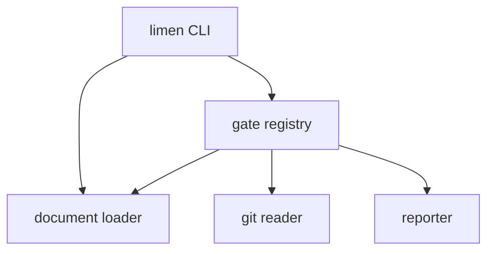

# Limen Validator: High-Level Design

<!-- agent:begin id="L1" hash="sha256:1802c72abded5fecf6d66683991077f9ac6b0bfda323a5d6bff807d560467db0" -->
A worked example. This document describes `limen` itself, in `brownfield-asis`
mode, and it passes all twelve gates. Read it beside `STD-LIMEN-02` to see what
each template looks like once filled in.

## L1.4 Quality attributes and scenarios
<!-- frames: C-02 -->

Five scenarios are registered in `registers/quality-scenarios.yaml`, covering
groundedness, speed, portability, modifiability and false-positive rate.

The conflict set is the interesting part, because two pairs genuinely compete:

| Pair | Tension | Winner | Rationale | Tier |
| :--- | :--- | :--- | :--- | :--- |
| `QA-01` vs `QA-02` | Every additional check costs wall-clock time in CI | `QA-01` | A fast validator that misses drift has no reason to exist. Speed is recovered by caching renders, not by checking less | `[T2]` |
| `QA-05` vs `QA-01` | Heuristics catch more real problems and also produce false findings | `QA-05` | A gate that cries wolf gets disabled, after which it catches nothing. Heuristic checks warn by default and only fail under `--strict` | `[T2]` |

That second decision is visible in the code: the strictness flag is threaded into
every gate rather than being decided per gate `[T1]`
(`tools/limen/limen/cli.py@9a5b391::IMPLEMENTED`).

## L1.9 Container topology
<!-- frames: C-04 -->

`limen` is a single process with no network dependencies. The **limen CLI**
parses arguments and dispatches to one of three subcommands. For `check`, the
**document loader** reads the document set once and exposes shared primitives, the
**git reader** provides revision-addressed access to the repository being
described, the **gate registry** runs twelve independent gates over those
primitives, and the **reporter** renders the result as text, JSON or SARIF.

<!-- c4: level=2 -->

The **git reader** is the only component that touches anything outside the
document set, and it does so read-only and addressed by revision, so a dirty
working tree cannot change a result `[T1]`
(`tools/limen/limen/gitio.py@9a5b391::Git`).

## L1.10 Trade-off index
<!-- frames: C-05 -->

| Dimension | Chosen | Rejected | Sacrifices | ADR | Tier |
| :--- | :--- | :--- | :--- | :--- | :--- |
| Symbol resolution | Layered regex, most precise layer first | tree-sitter with bundled grammars; exact string search | `QA-05` precision | `ADR-001` | `[T1]` |

The rejected options are recorded in full in the ADR, including why exact string
search defeats the gate's purpose rather than merely weakening it.
<!-- agent:end id="L1" -->
