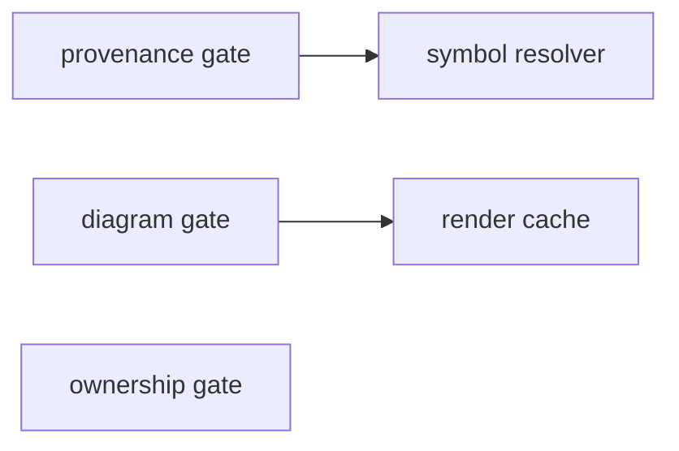

# L2 Mechanics

<!-- agent:begin id="L2" hash="sha256:c5cf63a28279bcf95e52650c0c10e60ce270da2237c351b21bae1c6c9f231402" -->
## L2.1 Components
<!-- frames: C-02, C-04 -->

The **gate registry** decomposes into twelve gates that share one loaded document
set. Three are shown; the rest follow the same shape.

<!-- c4: level=3 parent="gate registry" -->

- The **provenance gate** resolves every pointer at the baseline commit and, when
  `--at` is given, again at a second revision to report drift `[T1]`
  (`tools/limen/limen/gates/g1_provenance.py@9a5b391::DEFAULT_MIN_RESOLUTION` = 0.95).
- The **symbol resolver** is layered, and records which layer answered so a weak
  match can be reported rather than silently accepted `[T1]`
  (`tools/limen/limen/resolver.py@9a5b391::LOW_DURABILITY`).
- The **diagram gate** renders through mermaid-cli, discovered at run time rather
  than required at install time `[T1]`
  (`tools/limen/limen/gates/g2_diagrams.py@9a5b391::find_mmdc`).
- The **render cache** is keyed by diagram content, so an unchanged diagram costs
  nothing on the second run `[T1]`
  (`tools/limen/limen/gates/g2_diagrams.py@9a5b391::CACHE_NAME`).
- The **ownership gate** recomputes each agent block hash and refuses to treat a
  mismatch as something to repair `[T1]`
  (`tools/limen/limen/gates/g10_blocks.py@9a5b391::stamp`).

Every gate returns the same result shape, which is what lets the reporter stay
ignorant of what any individual gate checked `[T1]`
(`tools/limen/limen/model.py@9a5b391::GateResult`).

Gates never re-parse markdown. The document set is parsed once and exposes
sections, units, tables, pointers, diagrams and blocks `[T1]`
(`tools/limen/limen/docset.py@9a5b391::DocSet`). A thirteenth gate consumes those
primitives and touches no existing gate, which is what `QA-04` measures.

## L2.2 Interfaces
<!-- frames: C-01 -->

| ID | Contract | Kind | Consumer class | Error payload | Provenance | Tier |
| :--- | :--- | :--- | :--- | :--- | :--- | :--- |
| `I-01` | `limen check` | CLI | both | Findings with file, line and rule id | `tools/limen/limen/cli.py@9a5b391::main` | `[T1]` |
| `I-02` | `limen stamp` | CLI | agent | Lines changed, or none | `tools/limen/limen/gates/g10_blocks.py@9a5b391::stamp` | `[T1]` |
| `I-03` | `limen xrefs` | CLI | both | Broken reference, with file and line | `tools/limen/limen/xrefs.py@9a5b391::run` | `[T1]` |
| `I-04` | `--format sarif` | File | CI code scanning | SARIF 2.1.0 results | `tools/limen/limen/report.py@9a5b391::render_sarif` | `[T1]` |

The exit code is the contract that matters most, because CI reads it rather than
the report: zero for clean, one for a gate failure, two for a validator error and
three for drift against `--at` `[T1]` (`tools/limen/limen/cli.py@9a5b391::main`).

Bare invocation is treated as `check`, so an older invocation without a
subcommand still works `[T1]` (`tools/limen/limen/cli.py@9a5b391::normalize_argv`).

## L2.6 Failure modes
<!-- frames: C-03 -->

| Dependency | Class | On failure | Fallback | Tier |
| :--- | :--- | :--- | :--- | :--- |
| git repository | Hard for G1 and G9 | Provenance cannot be resolved at all | None. The gate fails rather than passing vacuously | `[T2]` |
| Baseline commit present locally | Hard for G1 | Shallow clones do not contain it | None. Reported as "baseline commit unavailable" so it is not mistaken for clean | `[T2]` |
| mermaid-cli | Soft | Diagrams cannot be rendered | Static lint still runs; the render step reports as skipped (`tools/limen/limen/gates/g2_diagrams.py@9a5b391::find_mmdc`) | `[T1]` |
| PyYAML | Hard | Front matter and registers cannot be parsed | None | `[T2]` |

The dangerous failure is the quiet one. A shallow CI checkout produces a repo
without the baseline commit, and the honest answer is an error rather than a pass,
because a vacuous pass is indistinguishable from a real one to whoever reads the
badge `[T2]`.

Whether the G3 similarity bands hold outside the test fixtures is undetermined
`[T0]`, tracked as `Q-02`
(`tools/limen/limen/gates/g3_consistency.py@9a5b391::HIGH_BAND`).
<!-- agent:end id="L2" -->
