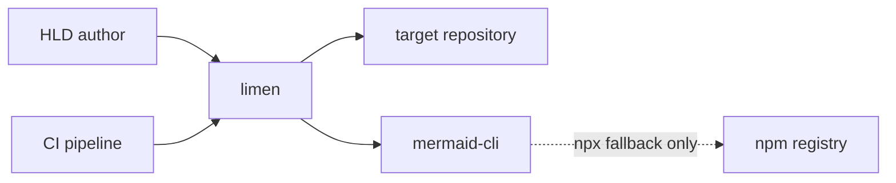
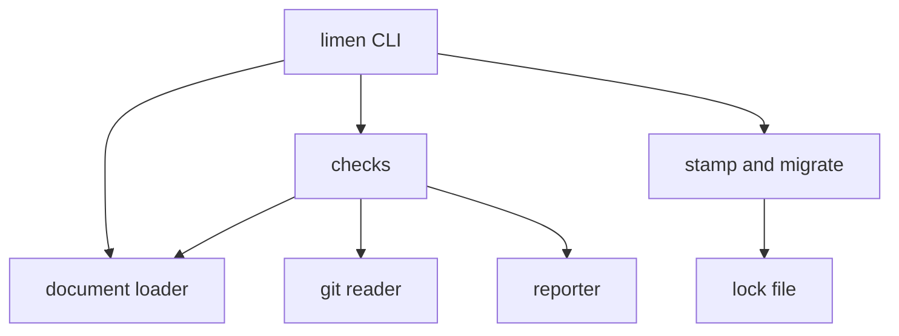

# Limen Validator: High-Level Design

A worked example of [`LIMEN.md`](../../LIMEN.md) 6.0. It describes `limen`
itself, so every verified claim points at real code at a real commit, and it
passes every check under `--strict`. It is deliberately small: most sections are
a paragraph, as a CLI tool's should be (LIMEN.md §12).

## 0. Summary

**What it is.** `limen` checks HLDs written to the Limen standard. It is one
Python process that reads a document set, resolves its pointers through git,
renders its diagrams through mermaid-cli, and reports five checks. It also
records who wrote each section (`stamp`) and converts 5.x documents
(`migrate`). This is version 6.0.0 `[verified]`
(`tools/limen/limen/__init__.py@3f20526::__version__` = 6.0.0).

**Shaping decisions.**

- Symbols are resolved by layered regex rather than tree-sitter (`ADR-001`),
  giving up some precision to need no grammars and no network.
- Ownership lives in a lock file keyed by heading (`ADR-002`), giving up
  per-paragraph granularity to keep markup out of the prose.

**Invariants.** Three tested, one untested, one violated: limen can reach the
network when mermaid-cli is not installed (`R-05`).

**Known divergences.** The constraints say limen runs with no network (`K-02`).
The diagram check's fallback downloads mermaid-cli from npm whenever it can.

**Top risks.** `R-05`, an unpinned download at run time. `R-04`, no CI runs any
check. `R-06`, the ownership protocol depends on the agent following it.

**Blocking questions.** None block a decision. `Q-01` decides whether the
declaration layer moves to tree-sitter.

## 1. Problem, scope and non-goals

**Problem.** An agent-written HLD is confident and often untrue, and it decays as
the code moves underneath it. Reading it cannot tell which claims still hold.
`limen` makes the mechanical part of that question cheap and repeatable: a claim
whose pointer stops resolving fails the way a broken test does.

**In scope.** Checking a document set, recording section ownership, and
converting 5.x documents.

| Non-goal | Why it is out | Who decided |
| :--- | :--- | :--- |
| Judging whether a claim is true | A resolving pointer proves the symbol exists, not that the sentence is right. That is the audit's job (LIMEN.md §9) | RFC-LIMEN-002 |
| Scoring documents | A score invites optimising the number. Findings and a verdict do not | RFC-LIMEN-002 |
| Parsing every language properly | A grammar per language is too much upkeep for one maintainer (`K-03`) | `ADR-001` |

## 2. Stakeholders and constraints

| ID | Stakeholder | Role | What they need to know |
| :--- | :--- | :--- | :--- |
| `C-01` | HLD author, agent or person | uses | When a check fails, which claim broke and what to change |
| `C-02` | Document reviewer | audits | Which claims were checked mechanically and which were only asserted |
| `C-03` | CI owner | operates | That the check is fast and quiet enough that nobody routes around it |
| `C-04` | Contributor | builds | How to add a check without touching the others |
| `C-05` | Maintainer | governs | That the tool and the standard do not contradict each other |

| ID | Class | Constraint | Source | Negotiable |
| :--- | :--- | :--- | :--- | :--- |
| `K-01` | technical | Python 3.9 or later, with PyYAML the only third-party dependency | It must run wherever the docs are checked out | No |
| `K-02` | operational | Must run with no network access | CI sandboxes and air-gapped review environments | No |
| `K-03` | organisational | One maintainer | Project reality | No |
| `K-04` | operational | Advisory on code PRs, blocking only on HLD PRs | A check that blocks every PR gets routed around | Yes |

## 3. Quality priorities

| ID | Rank | Attribute | Scenario | Measure |
| :--- | :--- | :--- | :--- | :--- |
| `QA-01` | 1 | Groundedness | A developer moves or changes a symbol that a verified claim points at | `--at HEAD` reports it; 0 missed in the test suite's moved and changed fixtures |
| `QA-05` | 2 | No false findings | An author checks a conforming document | 0 failures: the example and the clean fixture pass under `--strict` |
| `QA-03` | 3 | Portability | Someone runs limen with no network | Every check but rendering completes; at most one third-party dependency |
| `QA-02` | 4 | Speed | CI checks a document set of about 1,000 lines | Under 60 s with a warm render cache, under 5 s without diagrams |
| `QA-04` | 5 | Modifiability | A contributor adds a check | No existing check changes |

| Conflict | Tension | Winner | Why |
| :--- | :--- | :--- | :--- |
| `QA-01` vs `QA-02` | Every extra check costs CI time | `QA-01` | A fast checker that misses drift has no reason to exist; speed comes back from caching renders |
| `QA-05` vs `QA-01` | Heuristics catch more and also cry wolf | `QA-05` | A check that cries wolf gets disabled. Heuristic findings warn, and fail only under `--strict` |

Warnings fail only under `--strict` `[verified]`
(`tools/limen/limen/cli.py@3f20526::_check`). Nobody decided to trade `QA-03`
for convenience, but the diagram fallback does exactly that; see Invariants.

## 4. Context and containers

Conclude from this that limen keeps no state between runs except two files beside
the documents, the render cache and the lock, and that the dashed edge is the
only way it reaches the network. It reads the **target repository** only through
git, read-only and addressed by revision `[verified]`
(`tools/limen/limen/gitio.py@3f20526::Git`).

The five **checks** share one parsed document set from the **document loader**
`[verified]` (`tools/limen/limen/docset.py@3f20526::DocSet`), and each returns
the same result shape, so the **reporter** never needs to know what a check
examined `[verified]` (`tools/limen/limen/model.py@3f20526::CheckResult`). Only
**stamp and migrate** write the **lock file** (Data and consistency).

## 5. Key decisions

| Decision | Chosen | Rejected | Sacrifices | ADR | Tier |
| :--- | :--- | :--- | :--- | :--- | :--- |
| Symbol resolution | Layered regex, most precise layer first | tree-sitter with bundled grammars; exact string search | `QA-05` precision | `ADR-001` | `[verified]` |
| Ownership record | A lock file keyed by `##` heading | Inline hashed markers; git authorship; no record | Granularity: one edit anywhere makes a whole section a person's | `ADR-002` | `[verified]` |

## 6. Invariants

| Invariant | Tier | Basis | Checked | Status |
| :--- | :--- | :--- | :--- | :--- |
| A baseline commit missing from the repository fails `pointers`; it never passes | `[verified]` | `tools/limen/limen/checks/pointers.py@3f20526::run` | Read `run`. `test_greenfield` fails when the failure is replaced by an early return | `tested` |
| A deleted YAML key is reported missing, not moved | `[verified]` | `tools/limen/limen/resolver.py@3f20526::resolve` | `test_resolver` fails when the structured-path return in `resolve` is disabled | `tested` |
| An agent cannot claim a section recorded as a person's | `[verified]` | `tools/limen/limen/lock.py@3f20526::stamp` | `test_stamp` fails when the refusal in `stamp` is removed | `tested` |
| `limen check` writes nothing but the render cache | `[verified]` | `tools/limen/limen/checks/diagrams.py@3f20526::CACHE_NAME` | `git grep -n write_text` and `git grep -n os.replace` over `tools/limen/limen`: the cache and a temporary render file in a check, the lock in `stamp`, documents in `migrate`. No test | `untested` |
| limen never reaches the network | `[verified]` | `tools/limen/limen/checks/diagrams.py@3f20526::find_mmdc` | Read `find_mmdc`: with no `mmdc` on the path it runs `npx --yes -p @mermaid-js/mermaid-cli`, which downloads the package whenever npm is reachable | `violated`, `R-05` |

The last row is the useful one. The 5.x version of this document claimed limen
made no network calls; trying to break that claim found the fallback.

## 7. Data and consistency

| State | Owner | How it is written | If interrupted | Evidence | Tier |
| :--- | :--- | :--- | :--- | :--- | :--- |
| `.limen-lock.yaml` | `stamp` and `migrate` | Whole file, to a temporary file that is then renamed | The old lock survives intact | `tools/limen/limen/lock.py@3f20526::write` | `[verified]` |
| `.limen-cache.json` | The diagrams check | Overwritten in place, best effort | A corrupt cache reads as empty, and diagrams render again | `tools/limen/limen/checks/diagrams.py@3f20526::_load_cache` | `[verified]` |
| Migrated documents | `migrate` | Each file rewritten, then the lock written last | Files converted with no lock, so every section reads as a person's | `tools/limen/limen/migrate.py@3f20526::migrate` | `[verified]` |

The half-failure that matters is the third row. If `migrate` stops after
rewriting the files and before writing the lock, the ownership markers are gone
and nothing records them `[verified]`
(`tools/limen/limen/migrate.py@3f20526::migrate`). That fails safe, because
agents stop editing sections that read as a person's, but the agent's ownership
is lost and must be stamped again by hand. Checked: read `migrate`; it writes the
files inside its loop and the lock after it.

## 8. Failure and degradation

| Dependency | Hard or soft | On failure | Fallback | Evidence | Tier |
| :--- | :--- | :--- | :--- | :--- | :--- |
| git | Hard for `pointers` | limen exits 2, "not a git repository" | None | `tools/limen/limen/gitio.py@3f20526::Git` | `[verified]` |
| The baseline commit, present locally | Hard for `pointers` | `pointers` fails; a shallow CI clone hits this | None; CI needs `fetch-depth: 0` | `tools/limen/limen/checks/pointers.py@3f20526::run` | `[verified]` |
| mermaid-cli | Soft | Rendering is skipped with a warning, which `--strict` fails | Static lint still runs | `tools/limen/limen/checks/diagrams.py@3f20526::run` | `[verified]` |
| PyYAML | Hard | Front matter cannot be read; limen exits 2 | None | `tools/limen/limen/docset.py@3f20526::_yaml_load` | `[verified]` |

Each diagram render is cut off after 120 s `[verified]`
(`tools/limen/limen/checks/diagrams.py@3f20526::run` = 120). Without
mermaid-cli, four checks run normally and the fifth degrades to lint; nothing
else degrades `[inferred]`, from the rows above.

## 9. Security

**Assets.** The CI runner and its credentials, and the contents of the target
repository.

**Assumption.** The documents are as trusted as the code in the pull request that
changes them `[inferred]`. A pull request from outside the team breaks this
assumption for every row below.

| Boundary | Threat | Control | Residual | Risk | Tier |
| :--- | :--- | :--- | :--- | :--- | :--- |
| Document to git | A crafted path runs a git option or a shell command | git is called with an argument list, never a shell, and the path is joined to the revision as `rev:path`, so it cannot start with a dash (`tools/limen/limen/gitio.py@3f20526::Git`) | Low | n/a | `[verified]` |
| Document to YAML | Crafted front matter constructs arbitrary objects | Only `yaml.safe_load` is used (`tools/limen/limen/docset.py@3f20526::_yaml_load`) | Low | n/a | `[verified]` |
| Document to mermaid-cli | A crafted diagram attacks the renderer, a headless browser on the runner | Whatever sandbox mermaid-cli gives its browser; limen does not configure one | Not known | `Q-05` | `[unknown]` |
| npm registry to runner | A compromised mermaid-cli release runs on the runner | None: the fallback installs whatever version npm serves (`tools/limen/limen/checks/diagrams.py@3f20526::find_mmdc`) | **High** wherever the fallback runs | `R-05` | `[verified]` |

## 10. Risks and open questions

| ID | Type | Description | Impact | Owner | Mitigation | Evidence | Tier |
| :--- | :--- | :--- | :--- | :--- | :--- | :--- | :--- |
| `R-01` | Risk | Declaration patterns miss unusual formatting, so a correct pointer reads as unresolved | Medium | @maintainer | The resolver records which layer matched, and `--strict` rejects weak matches | `ADR-001` | `[verified]` |
| `R-04` | Risk | No CI runs any check: the repository has a remote but no workflow | High | @maintainer | The second proposal below | `git ls-tree -r --name-only` at the baseline lists no `.github/` path | `[inferred]` |
| `R-05` | Issue | With no mermaid-cli installed, the diagram check downloads it unpinned from npm, breaking `K-02` and trusting whatever npm serves | High | @maintainer | The first proposal below | `tools/limen/limen/checks/diagrams.py@3f20526::find_mmdc` | `[verified]` |
| `R-06` | Risk | Ownership depends on the agent: nothing stops `--mine` on a section a person changed but never recorded | Medium | @maintainer | Accepted. LIMEN.md §8.3 tells agents to check before editing | `tools/limen/limen/lock.py@3f20526::stamp` | `[verified]` |
| `R-07` | Risk | Renaming a heading drops its lock entry, so the section reads as a person's until stamped again | Low | @maintainer | Fails safe, and `ownership` warns about the orphaned entry | `tools/limen/limen/checks/ownership.py@3f20526::run` | `[verified]` |

- Pin mermaid-cli and remove the `npx --yes` fallback, so that a missing renderer
  means a skipped render and never a download `[proposed]`, owner @maintainer,
  trigger: the first CI run on pull requests from outside contributors.
- Run the test suite on every pull request `[proposed]`, owner @maintainer,
  trigger: the next change to `tools/limen/`.

| ID | Question | Why it matters | Owner | How it gets resolved |
| :--- | :--- | :--- | :--- | :--- |
| `Q-01` | Should the declaration layer move from regex to tree-sitter? | Regex patterns miss unusual formatting (`R-01`) | @maintainer | Measure the miss rate on a real multi-language repository |
| `Q-04` | Is a `##` section the right unit of ownership, or do long sections need finer grain? | One edit anywhere makes a whole section a person's (`ADR-002`) | @maintainer | Count sections recorded as a person's after a month of real use |
| `Q-05` | Does mermaid-cli run its browser sandboxed on CI runners? | Decides the residual risk of rendering untrusted diagrams | @maintainer | Read mermaid-cli's browser launch options, then test on a runner |

## 11. Contract catalogue

Triggered because CI and agents consume the CLI.

| ID | Contract | Consumers | Errors | Evidence | Tier |
| :--- | :--- | :--- | :--- | :--- | :--- |
| `I-01` | `limen check` exits 0 on a pass, 1 on a failure, 2 when it cannot run, 3 on drift | CI, agents | Each finding names a file, a line and the check | `tools/limen/limen/cli.py@3f20526::main` | `[verified]` |
| `I-02` | `limen stamp` with `--all`, `--mine` or `--human` | Agents | A refusal exits 1 and says why | `tools/limen/limen/lock.py@3f20526::stamp` | `[verified]` |
| `I-03` | `limen migrate`, optionally `--dry-run` | People converting 5.x documents | Lists every change, and what is left to do by hand | `tools/limen/limen/migrate.py@3f20526::migrate` | `[verified]` |
| `I-04` | `--format json` and `--format sarif` | CI, code scanning | SARIF 2.1.0 results | `tools/limen/limen/report.py@3f20526::render_sarif` | `[verified]` |

The exit codes and the check names are the contract, so renaming a check is a
breaking change. The 5.x gate ids still map to checks for one minor version
`[verified]` (`tools/limen/limen/cli.py@3f20526::GATE_ALIASES`).
