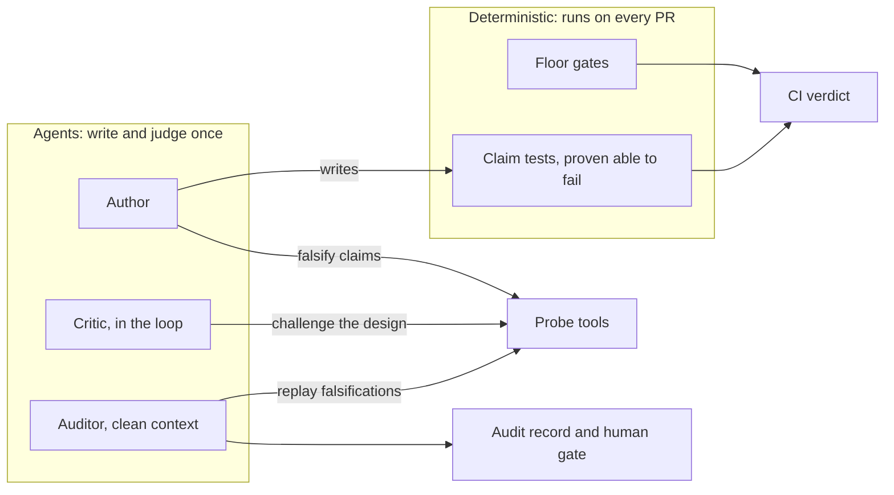
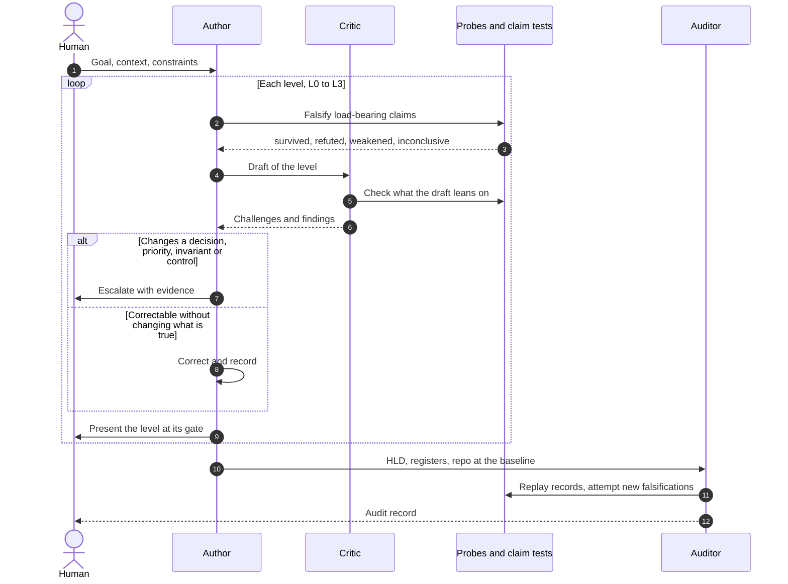

# RFC: From Format Gates to Claim Tests

**Document Reference:** `RFC-LIMEN-001`  
**Revision:** 2 (supersedes revision 1, *Tool-Augmented Agentic Validation*; see §13)  
**Status:** Withdrawn, superseded by [`RFC-LIMEN-002`](../RFC-limen-core.md). Kept for its §2 evidence.  
**Target Release:** Limen 6.0 for Phases 0–2; Phases 3–6 staged after (§12)  
**Related Standards:** [`STD-LIMEN-01`](../../STD-LIMEN-01-Framework.md), [`STD-LIMEN-02`](../../STD-LIMEN-02-Templates.md), [`STD-LIMEN-03`](../../STD-LIMEN-03-Audit.md), [`tools/limen`](../../tools/limen/README.md)

---

## 1. Summary

Limen exists to produce a good system design, whether created from requirements
or extracted from a running system. Today it is measured by something else:
whether a document passes twelve gates (G1–G12). Most of those gates check
markup (tags, comments, counts, tense), and an authoring agent spends its
attention satisfying them.

Revision 1 proposed moving judgment from the gates to an Auditor Agent. The
direction is right, but it changes who checks the document and leaves how the
design is made untouched. The evidence in §2 points along a different axis. What
found the problems in a real HLD was neither a gate nor careful reading. It was
**trying to disprove load-bearing claims against the code, and running things.**

This revision proposes that Limen 6.0:

1. **Tests claims, not markup.** A small deterministic floor stays blocking.
   Gates that check form are narrowed, demoted or retired (§5).
2. **Falsifies while authoring.** Every load-bearing claim carries a recorded
   attempt to disprove it, made by the author with probe tools and replayed by
   the auditor (§6).
3. **Turns key invariants into claim tests that are proven able to fail.**
   Agents write them once; machines run them on every PR (§7).
4. **Separates the critic from the judge.** An in-loop critic challenges the
   design; a clean-context auditor scores it (§8).
5. **Helps with design, not only documentation.** Greenfield and change work get
   explicit design moves: candidates, scenario walkthroughs, a premortem (§9).
6. **Writes for the reader.** A short core first, with the evidence behind it (§10).
7. **Measures "good" before changing anything.** Phase 0 builds an evaluation set
   and a baseline (§11).



---

## 2. Evidence: the tern_poc run

Revision 1 argued from hypothetical cases. There is now a real one. Limen was
pointed at an HLD for `tern_poc`, a browser-based geospatial app built by one
engineer, documented as `brownfield-asis` under profile `P2-product-service`. The
HLD runs to 2,716 lines across four files, with 275 tier tags, 35 `frames:`
comments and 169 provenance pointers. An independent audit under `-03` §4
followed (`tern_poc/docs/architecture/audits/2026-09-16-1.1.0.yaml`).

### 2.1 The gates passed; the claims did not

| Measure | Result |
| :--- | :--- |
| `limen check --strict` | 11 of 12 gates pass; G6 fails on tagging |
| Provenance resolution | 169 of 169 pointers resolve |
| Auditor's provenance sample, checking the sentence and not only the symbol | 34 sampled; 29 fully true, 2 quoted values wrong, 3 sentences false at the baseline |
| Tier spot-check | 1 of 10 claims correct in both tier and content |
| Falsification of load-bearing claims | 10 attempts: 9 refuted or weakened, 1 confirmed |
| Drift on `main` | `limen` reports none; the CSP `connect-src` count went from 9 to 10 and `base-map.ts` was rewritten |

G1 passed because it checks that a symbol exists, not what the prose says about
it. Drift went unseen because 71 of the 169 pointers name whole files, and a
whole-file pointer resolves for as long as the file exists.

### 2.2 What found the defects

The auditor's falsification attempts, several of them made by executing code at
the baseline commit, found defects in the **system**, not in the document:

| Audit ID | What the HLD claimed | What falsification found |
| :--- | :--- | :--- |
| F5 | LLM requests are bounded by a 90 s deadline | The timer is cleared when headers arrive and `res.json()` runs unbounded. Executed against a server that stalls the body: still pending at 2.67× the deadline |
| F6 | All engine table registration goes through the op queue, enforced by a test | 9 call sites in 4 modules bypass the queue. The test checks the ordering of ops already enqueued and passes with the bypass present |
| F1 | The SQL validator is the single chokepoint for untrusted SQL | It has one caller, and it admits file reads through DuckDB replacement scans. Executed on the engine version pinned in the lockfile |
| F2 | A failed registration leaves a table that cannot be queried, with no fallback | The attribute table has a designed pure-JS fallback. Here the system is better than the HLD says |

F6 led directly to a code fix (`tern_poc@0cbe76e`, *every register and drop goes
through the queue*). It is guarded by a call-site spec that was committed as
`it.fails` against the unfixed code and flipped when the fix landed. That
sequence is what this revision proposes making standard: claim, falsification,
defect, fix, and a check shown able to fail (§7).

### 2.3 What the gates cost

- **The tagging gate measured tags.** G6 failed the strict run on 17 `[T1]`
  claims without pointers, mostly STRIDE rows. Meanwhile three `[T1]` claims with
  valid pointers were false, and G6 had nothing to say about them.
- **A format failure produced a format check.** The response to the first audit's
  count errors was FF-10, a script that re-derives counts. The second audit found
  that it checks one sentence per count and passes over a false count of exactly
  the kind it was written to catch.
- **Nothing asks whether a check can fail.** The specs credited with enforcing the
  F1 and F6 properties pass with both violations present.
- **Length.** 2,716 lines is a heavy read for a pre-launch app with one engineer.
  The root README §8 names over-application as the standard's most likely
  failure; this HLD is an instance of it.

### 2.4 What revision 1 got right, and what it missed

Revision 1 was right on three counts. Mechanical gates are semantically blind (its
§2.1, borne out by F5 and F6). Authors game markup (§2.2, borne out by G6 and
FF-10). Drift needs judgment (§2.3, borne out by the drift on `main` that limen
missed).

It missed five things:

1. **It is still about validation.** It changes who checks the document and says
   nothing about how a design is made or extracted.
2. **An auditor inside every level's loop stops being independent.** Once its
   suggested diffs are applied it is a co-author, and the independence `-03` §4.1
   requires is gone. The tern_poc auditor already disclosed that a model from the
   author's own family may share its blind spots.
3. **It drops determinism where CI needs it.** A blocking verdict has to be cheap
   and reproducible.
4. **It trusts PR text.** Its Scenario A classifies a change as a refactor from
   the PR description. A PR description is a claim too.
5. **An LLM reviewer can be gamed.** Persuasive prose moves a reader. Executed
   evidence does not.

---

## 3. Goal and non-goals

**Goal.** A Limen HLD is good when its load-bearing claims are true, the ones
that matter most have been tested against the system, its decisions are real
choices with stated sacrifices, and a reader can find the important parts fast.

**Non-goals.**

- **Replacing human review of the design.** Gates 0–2 stay.
- **Making every check agentic.** Agentic judgment is expensive and
  nondeterministic. It goes where nothing deterministic can.
- **A universal static analyzer.** Limen records probe results in a replayable
  form. It does not need call-graph analysis for every language (§6.3).

---

## 4. Principles

1. **Test claims, not markup.** A deterministic check earns blocking status only
   if it checks something true of the system, or protects a human's edit.
2. **Falsify before asserting.** The author, not just the auditor, tries to
   disprove each load-bearing claim.
3. **Agents write checks; machines run them.** Judgment is spent once, at
   authoring, and the result runs on every PR.
4. **A check that cannot fail is not a check.** Every claim test is shown failing
   on a violation before it is trusted.
5. **Evidence has a rank.** Executed beats traced through call sites, which beats
   read at a declaration, which beats named in docs or PR text. This extends
   `-01` §6.1 D-1 and D-2.
6. **Critic and judge are different agents.**
7. **Reader first.** Length is a cost, and every reader pays it.

---

## 5. Gate disposition

| Gate | 5.x | 6.0 | Reason |
| :--- | :--- | :--- | :--- |
| **G1** Provenance | Blocking | **Blocking, tightened** | Resolution and quoted literals are true of the system. New: a load-bearing claim cannot rest on a whole-file pointer (§5.1) |
| **G2** Diagrams render | Blocking | **Blocking** | Cheap and precise; a diagram that does not render cannot be reviewed |
| **G3** Name consistency | Blocking, heuristic band | Warning | Useful lint. A near-duplicate name is rarely a design defect |
| **G4** Concern coverage | Blocking | Retired as a gate; `frames:` optional | It measures comments. Concern coverage moves to the silence audit (`-03` §4.2 item 3), where it is judged on substance |
| **G5** Response measures | Blocking | Warning | A numeric measure says nothing about whether the number is right. Critic and auditor judge that |
| **G6** Tier tagging | Blocking | **Narrowed**: tags well-formed (Rule T-3); load-bearing claims tagged (§5.2) | Tagging every sentence is the largest markup tax. Tiers matter on claims that something else depends on |
| **G7** Proposal hygiene | Blocking, tense heuristic | Owner and trigger blocking; tense heuristic retired | Owner and trigger are cheap and useful. Tense regexes produce contorted prose |
| **G8** Open questions | Blocking; empty register fails | `[T0]` to `Q-nn` resolution blocking; the non-empty rule becomes an auditor signal | An empty register is a red flag for a person to read, not a mechanical failure. Enforcing it invites invented questions |
| **G9** Front matter | Blocking | Schema and single baseline blocking; `counts` retired | Counts are bookkeeping |
| **G10** Block ownership | Blocking | **Blocking** | It protects human edits, the one place a content hash is the right tool |
| **G11** Mode discipline | Blocking, tense heuristic | `[AS-IS]`/`[TO-BE]` marker separation and L3.8 presence blocking; tense heuristic retired | Same reasoning as G7 |
| **G12** ADR externality | Blocking | **Blocking** | Decisions outside the HLD (`-01` §8) is a structural rule and cheap to check |
| **G13** Claim tests | n/a | **Blocking on HLD PRs** | Every claim test passes at HEAD and fails on its declared mutation (§7) |

Retired checks stay available as warnings under `--legacy` for one minor version,
so existing CI does not break on upgrade. Exit codes 0–3 keep their meaning.

### 5.1 Pointer granularity

A pointer without `::symbol` may support a claim about a file as a whole: that it
exists, what it lists, how it is configured. It may not support a claim about
behavior: an ordering, a bound, a guarantee, a fallback, a control. The 71
whole-file pointers in tern_poc are why the drift on `main` went unseen.

G1 cannot tell a behavioral claim from any other on its own, so the rule is
enforced through §5.2. A load-bearing claim whose only pointer is whole-file
fails G1.

### 5.2 Load-bearing claims

A claim is **load-bearing** when something else depends on it: an invariant
(L1.5); a consistency, ordering or delivery guarantee (L2.4); a security control
credited against a residual risk (L2.5); a failure behavior or fallback (L2.6); a
timeout, limit or budget; or any QA scenario, SLO, risk or ADR that cites it.

- **Declared, not inferred.** A claim declares itself load-bearing by citing a
  falsification record (`FA-nn`, §6.2). Rows in the L1.5, L2.4, L2.5 and L2.6
  tables are load-bearing by position.
- **What it must carry.** A tier tag, a symbol-level pointer if `[T1]`, and a
  falsification record if `[T1]` or `[T2]` (Rule T-5).
- **Everything else may go untagged.** Narrative, orientation and context are not
  claims anyone builds on.
- **Under-declaration is an audit finding.** A claim that something depends on
  but that carries no `FA-nn` is caught by the auditor, not by a gate (§14.2 Q3).

---

## 6. Falsification while authoring

### 6.1 The rule

Proposed for `-01` §4:

> **Rule T-5 (falsify before asserting).** A load-bearing `[T1]` or `[T2]` claim
> cites a falsification record stating what would show it false, how that was
> looked for, and what was found. A claim whose falsification found a
> counterexample is not asserted. It becomes a corrected claim, a finding raised
> as an `R-nn`, or a `[T0]`.

A `[T1]` claim whose entire content is a quoted literal needs no record: G1
compares the literal with the code, and that comparison is its falsification.

### 6.2 Falsification records

A new register, `registers/falsifications.yaml`, with `FA-nn` identifiers.
Illustrative entry, built from audit finding F6:

```yaml
- id: FA-06
  claim: "All layer-table registration goes through enqueueDuckdbOp"
  cited_in: [L1.5, L2.4]
  falsifier: "Any register or unregister call that does not pass through the queue"
  method: traced              # executed | traced | read | measured
  probe:
    kind: call_sites
    target: "src/services/duckdb.ts::registerLayerTable"
    command: "git grep -n 'registerLayerTable\\|unregister' ed42d9a -- src"
  at: ed42d9a
  outcome: refuted            # survived | refuted | weakened | inconclusive
  evidence: "9 direct calls in 4 modules: attribute-table-element.ts, grid-state.ts, copilot-element.ts, duckdb.ts"
  disposition: "Claim corrected; queue bypass raised as a risk; claim test FF-08 added"
  claim_test: FF-08
```

| Outcome | What the document does |
| :--- | :--- |
| `survived` | The claim stands at its tier |
| `weakened` | The claim is narrowed to what survived, and the record says what was cut |
| `refuted` | The claim is corrected, and the defect becomes a finding (§7.3 status `violated`) |
| `inconclusive` | The claim becomes `[T0]` with a `Q-nn` |

### 6.3 Probe tools

These are the senses that found the tern_poc defects. Revision 1's document tools
(§13) remain, but they check the document, and these check the system.

| Probe | Answers | Falsifies claims like |
| :--- | :--- | :--- |
| `call_sites(symbol)` | Every caller, at the baseline | "X is the only path to Y" |
| `writers(state)` | Every write to a field, table, key or global | "Component A owns state S" |
| `path_guards(entry, kind)` | What timer, lock, transaction or handler covers each hop on a path | "Requests are bounded"; "the write is atomic" |
| `run_at(commit, command)` | Executes a command in a throwaway worktree at a commit; captures output and exit code | Anything runnable: bounds, fallbacks, bypass inputs |
| `measure(commit, command)` | A number, with the method that produced it | Sizing, memory, latency |
| `resolve(pointer)` | Symbol resolution and literal comparison (revision 1's `limen_resolve_provenance`) | Existence and quoted values |

**Limen does not implement `call_sites`, `writers` or `path_guards` for every
language.** The agent fulfils a probe with whatever it has (grep, an LSP,
tree-sitter, a test) and records the command it ran. Limen owns the record
format and `run_at`, so any probe recorded as a command can be replayed (§8.3). A
probe that cannot be replayed ranks as `read`.

### 6.4 Depth by profile

Falsification is not free, though it replaces work this revision removes
(per-sentence tags, `frames:` comments, counts, tense contortions). The minimum
set grows with the profile (`-03` §2):

| Profile | Must falsify |
| :--- | :--- |
| `P1`, `P5` | Every L1.5 invariant and every L2.6 fallback |
| `P2`, `P3` | Those, plus L2.4 guarantees and L2.5 credited controls |
| `P4` | Every load-bearing claim |

---

## 7. Claim tests: invariants proven able to fail

### 7.1 From falsification to claim test

A falsification runs once. A claim test runs on every PR. Where a falsifier can
be automated, the author turns it into a fitness function (`-01` §3.7.1, `-02`
§17) bound to the claim it enforces.

### 7.2 Proven able to fail

Proposed for `-01` §3.7.1:

> **Rule F-2 (a check must be shown to fail).** A fitness function credited with
> enforcing a claim declares a mutation, a patch that violates the claim.
> `limen claimtest` runs the check at HEAD, where it must pass, then applies the
> mutation in a throwaway worktree and runs it again, where it must fail. A check
> that passes on its own mutation enforces nothing, and G13 fails.

```yaml
- id: FF-08
  enforces: [FA-06]
  command: "npx vitest run --project unit duckdb-callsites.spec.ts"
  mutation: mutations/FF-08-direct-register.patch
  where: "CI, HLD PRs and nightly"
  on_failure: "Block merge"
```

The inverse form also counts. A spec committed as `it.fails` against code that
violates the claim, recorded with that commit, is a demonstrated failure, which
is how tern_poc proved its call-site spec in `0cbe76e`.

Mutation patches rot as code moves. A mutation that no longer applies is
reported as drift (exit 3), not as a gate failure, and prompts the author to
regenerate it (§14.2 Q2).

### 7.3 Invariant status

Each L1.5 invariant shows exactly one status:

| Status | Meaning |
| :--- | :--- |
| `tested` | A claim test passes and has been shown to fail on its mutation |
| `untested` | No claim test exists; the reason is stated |
| `violated` | A claim test or falsification found a counterexample |

A `violated` invariant is a design finding, stated plainly. It is the most
valuable line an HLD can contain, and the audit rewards it (§8.3).

### 7.4 Revision 1's Scenario B under this model

The invariant is *"billing completes synchronously before the user gets a
response."* Its claim test is an integration test in which the billing API fails
and the request must return an error. Its mutation wraps the billing call in a
detached goroutine. The PR that makes exactly that change fails the claim test,
deterministically, with no LLM in the blocking path. The agent's work came
earlier: stating the invariant, finding its falsifier, and writing the test.

---

## 8. Roles and the authoring loop

### 8.1 Roles

| Role | Context | Does | Never |
| :--- | :--- | :--- | :--- |
| **Author** | Full authoring context | Writes sections, falsifies its own claims, writes claim tests | Audits its own work (`-01` §11 rule 14) |
| **Critic** | The draft and the probes; may run as a subagent of the author's session | Challenges each level: straw-man alternatives, unstated sacrifices, unfalsified load-bearing claims, missing failure paths | Scores, approves, or edits the document |
| **Auditor** | Clean, per `-03` §4.1; a different model or prompt from the author where available | Replays falsifications, attempts its own, runs the silence audit, recomputes arithmetic, scores | Sees the transcript or the critic's notes |
| **Human** | n/a | Decides at Gates 0–2 and on escalations (§8.2) | n/a |

The critic's findings go to the author, who decides what to do with them.
Disagreements surface at the human gate. This gives revision 1's in-flight review
a home without costing the auditor its independence.

### 8.2 When the loop stops for a human

Escalate when a finding changes any of these:

- **A decision:** an ADR's outcome or what it sacrifices.
- **A priority:** the L1.4 quality ordering.
- **An invariant:** its status moves to `violated`.
- **A control:** a security control no longer holds what it is credited with.

The author corrects everything else alone: pointer and literal repairs, arithmetic,
naming, and tier corrections that do not change what is true.



### 8.3 Audit changes (`-03` §4.2, §9, §11)

- **Provenance sampling checks the sentence.** Item 1 keeps its sample size but
  verifies that the supported sentence is true, not only that the symbol
  resolves. G1 already resolves every symbol mechanically.
- **New: falsification replay.** Replay `max(3, 20%)` of the records with
  `method: executed` or a recorded command, and re-derive a sample of `read`
  records. A replay that contradicts its record is a **Blocker**.
- **Item 2 retargets.** The auditor's own falsification attempts go to
  load-bearing claims the author recorded as `read`, or did not declare.
- **New: claim-test review.** For each credited fitness function, does its
  mutation actually violate the claim? A trivial mutation proves nothing.
- **New penalty.** A load-bearing claim recorded as `survived` that the auditor
  refutes costs more than a straw-man alternative.
- **Rule S-3 extends to violations.** A refuted claim the author disclosed as
  `violated` costs nothing. An auditor who penalizes disclosed violations teaches
  the next author to stop looking.
- **Audit record.** `-03` §11 gains `falsification_replay` and `claim_tests`
  sections. Revision 1's Review Brief folds into it.

---

## 9. Design moves: greenfield and brownfield-change

Falsification covers extraction. Creation needs more than templates, so L1 gains
an ordered set of design moves. Each one produces an artifact the critic can
attack.

| Move | Produces | The critic checks |
| :--- | :--- | :--- |
| **1. Forces** | Constraints, prioritized QA scenarios, conflict set (L0.4, L1.4, as today) | Priorities are ranked, not all High |
| **2. Candidates** | At least two materially different candidates, each a paragraph and a C4 L2 sketch | They differ in at least one of: deployment units, state ownership, consistency model, sync/async boundary, trust-boundary placement. Variants of one design do not count |
| **3. Scenario walkthrough** | A table of candidates against the top 3–5 QA scenarios: how each responds, where each strains | The chosen candidate loses somewhere. If it wins every row, the candidates were straw men |
| **4. Premortem** | *"A year from now this design failed. Why?"* At least three causes, each landing as an `R-nn`, a QA scenario or a fitness function | Causes are specific to this design (Rule S-1) |
| **5. Decision** | An ADR (`-01` §8) citing the walkthrough rows it trades | Its sacrifices match the walkthrough |

In `brownfield-change`, the as-is design is candidate zero and appears in the
walkthrough. If staying put wins every row, the change is not justified.

Proposed for `-01` §8:

> **Rule A-3 (candidates before decisions).** A shaping ADR at L1.10 cites a
> scenario walkthrough containing at least two materially different candidates.

---

## 10. Reader-first output

A new `00-summary.md` leads the HLD. It is written last, runs to about two pages,
and has a fixed shape:

1. What the system is and the problem it solves, in three to five sentences.
2. Shaping decisions, one line each, with the sacrifice and the ADR link.
3. Invariants with their status (§7.3).
4. Known divergences: where the system does not do what its design intends.
5. Top risks, at most five.
6. Open questions that block a decision.

The rest of the HLD is the evidence behind that page. The `-02` templates stay
and collapse by profile, as root README §8 already says. `limen check` reports
length per level against a profile guide but never gates on it. The guide's
numbers come from Phase 0 data, not from this RFC.

---

## 11. Evaluation (Phase 0)

No phase ships without showing that it improves the HLDs limen produces. Without
an evaluation, switching to agentic review swaps one proxy for another.

### 11.1 Evaluation set

| Case | Ground truth |
| :--- | :--- |
| `tern_poc` at `ed42d9a` | The 1.1.0 audit: 10 falsification outcomes, 34 provenance sample results, 10 tier verdicts, recomputed budgets and sizing |
| `examples/limen-hld/` | Small and fully known. Guards against regressions on a conforming document |
| Seeded regressions | Copies of both repos, each with one injected architectural change that breaks a named invariant: a queue made unbounded, a serializing queue bypassed, a timer removed from a path, a synchronous call made fire-and-forget, a validator's caller removed |
| A second real system | Not yet chosen (§14.2 Q1). One real codebase is too few to tune against |

### 11.2 Metrics

| Metric | Definition | Baseline, tern_poc 1.1.0 |
| :--- | :--- | :--- |
| Claim precision | True load-bearing claims ÷ sampled load-bearing claims | 1 of 10 survived falsification; 29 of 34 pointer-backed sentences fully true |
| Defect disclosure | Known system defects the HLD itself discloses ÷ known defects | 0 of 3 (F1, F5, F6 were all found by the auditor) |
| Claim-test validity | Credited checks that fail on a violation ÷ credited checks | The specs credited with the F1 and F6 properties pass with both violations present |
| Regression detection | Seeded regressions caught in update mode ÷ seeded | Not yet measured |
| Reader cost | Lines in the core summary; lines in total | No summary; 2,716 lines |
| Authoring cost | Tokens and wall time per level | Not yet measured |

### 11.3 Acceptance

A phase ships only if it does not lower claim precision or defect disclosure on
the evaluation set, and it improves the metric it targets. Phase 1 in particular
must hold precision steady while lowering authoring cost; that is the test of
whether the retired gates were doing anything.

---

## 12. Rollout

| Phase | Delivers | Standard changes | Tool changes | Exit criterion |
| :--- | :--- | :--- | :--- | :--- |
| **0** Measure | Evaluation set, metrics harness, baseline | None | Evaluation harness under `tools/limen/eval/` | Baseline recorded for every metric in §11.2 |
| **1** Cut ceremony | Gate disposition (§5), load-bearing claims (§5.2) | `-01` §4, §10.3; `-03` §5, §6 | G1 pointer granularity; G3, G5 to warnings; G4, G8 non-empty, G9 counts, G7/G11 tense retired; `--legacy` | Precision held; authoring cost down |
| **2** Falsify while authoring | Rule T-5, falsification register, probe records, `run_at`, critic role | `-01` §4, §6, §11; `-02` new register template; `-03` §4.2, §9, §11 | `limen run-at`; register schema; replay | Defect disclosure above zero on tern_poc; precision up |
| **3** Claim tests | Rule F-2, G13, invariant status | `-01` §3.7.1; `-02` §17; `-03` §5 | `limen claimtest` (worktree, mutation, run) | Every credited check fails its mutation; seeded regressions caught |
| **4** Design moves | §9 moves, Rule A-3 | `-01` §3.3, §8; `-02` §9 | None | Measured on a greenfield case (§14.2 Q7) |
| **5** Update loop | Revision 1's §5, on top of Phases 2 and 3 | `-01` §7 | PR-triggered: claim tests block; agentic review comments | Seeded regressions caught; refactor-only seeds raise no escalation |
| **6** Reader-first | `00-summary.md` (§10) | `-01` §10.1; `-02` new template | Length report | Summary produced; reviewers rate it against the full HLD |

Phase 6 depends on nothing else and is cheap, so it can ship alongside Phase 1.
Phase 1 changes what the gates mean, so it takes the standards to 6.0.0.

---

## 13. Revision 1, mapped

| Revision 1 | Revision 2 |
| :--- | :--- |
| §3 Gates refactored into sensory tools | Kept as the document tools: `resolve_provenance`, `parse_diagram`, `extract_registers`, `detect_code_drift`. §6.3 adds the probes that check the system |
| §4 Auditor in every level's loop | Split into an in-loop critic and an end-of-run auditor (§8) |
| §4.1 Architectural Review Brief | Folded into the audit record (§8.3) |
| §5 Semantic Drift Engine | Phase 5, with claim tests as the blocking signal and agentic review advisory |
| §5.1 Scenario A, refactor | Classified by evidence: if claim tests still pass and falsification records still replay as `survived` at HEAD, only pointers are repaired. The PR description is context, not evidence |
| §5.1 Scenario B, silent invariant change | Caught deterministically by a claim test (§7.4) |
| §6 Tool specifications | §6.3 |
| §7 Migration plan | §12 |
| §8 Open questions | Answered in §14.1 |

---

## 14. Questions

### 14.1 Answered from revision 1

1. **Auditor context isolation.** A clean context is required for the audit, and
   a different model or prompt from the author's is preferred. The in-loop critic
   may run as a subagent, but its output never counts as the audit.
2. **CI integration.** Block on the floor gates and the claim tests, both
   deterministic. Agentic review runs on PRs that touch paths the HLD points at,
   posts comments, and never blocks.
3. **Human gate triggers.** §8.2.

### 14.2 Open

1. **A second system for the evaluation set.** Ideally open source with a public
   incident history, so that known defects are ground truth. Which one?
2. **Mutation rot.** Patches stop applying as code moves. Regenerate them on
   drift, which costs agent time, or express mutations semantically, which is
   harder to make deterministic?
3. **Under-declaration.** Load-bearing status is declared, so an author can dodge
   Rule T-5 by not declaring. Is auditor detection enough, or should G6 warn on
   claims that look load-bearing and cite no `FA-nn`?
4. **Critic model.** The author's own model is cheap and shares its blind spots;
   another model costs more. Phase 2 should measure the difference.
5. **Where falsification records live.** This revision puts them in the HLD's
   registers, because they are the author's evidence and the auditor replays
   them. The alternative is beside the audit records.
6. **Cost of agentic review per PR.** It needs a budget before Phase 5 is on by
   default.
7. **Greenfield evaluation.** The evaluation set has no greenfield case, so
   Phase 4 cannot be measured until one is added.

---

## 15. Revision history

| Revision | Date | Change |
| :--- | :--- | :--- |
| 1 | 2026-09-24 | *Tool-Augmented Agentic Validation*: gates refactored into tools for an Auditor Agent working inside the authoring loop |
| 2 | 2026-10-09 | Reframed from validation to claim testing on tern_poc evidence: falsification during authoring, claim tests proven able to fail, a critic separate from the auditor, design moves, reader-first output, and a Phase 0 evaluation |
